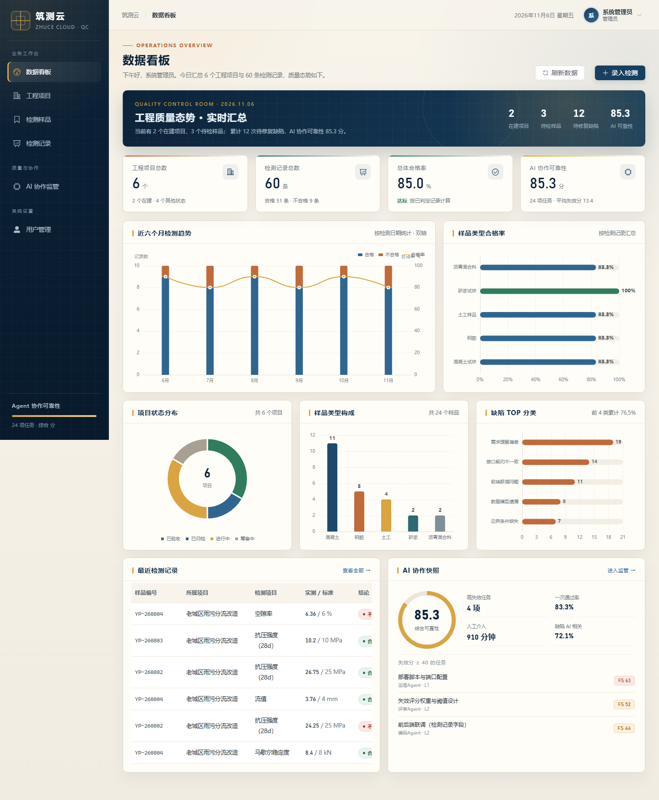

# 筑测云 · 工程检测数据管理平台

> 软件工程大作业 · 生成式软件工程实践  
> 前后端 + 数据库 + 工程文档 + AI 分级与失效评分监管  
> 代码仓库（GitHub 公开）：<https://github.com/GitHubZGJ/Zhuce_Yun>

筑测云面向施工项目部与中小检测机构，提供“工程项目—检测样品—检测记录—自动判定—质量看板”的业务闭环，并把 AI 任务分级、五维失效评分、缺陷帕累托与可靠性统计做进系统，用可运行的方式落实作业中的 AI 治理要求。



## 核心能力

- **工程与检测业务**：项目、样品、检测记录 CRUD；GTE/LTE 自动判定；样品状态联动；多条件筛选与分页。
- **质量看板**：项目、样品、记录、合格率、AI 可靠性 KPI；六个月趋势、类型合格率、项目状态、样品构成、缺陷 TOP、最近记录。
- **权限与用户**：管理员、检测工程师、查阅人员三角色；JWT + RBAC；管理员自保护；越权接口返回 403。
- **AI 协作监管**：24 条任务台账；L1/L2/L3 分级；五维失效评分；各阶段综合可靠性；高失效案例；缺陷帕累托；分级机制页。
- **可验证质量**：56 个 pytest 全部通过，语句覆盖率 88%；Edge + playwright-core 完成 10 个场景、12 张页面截图，浏览器与 API 无错误。
- **工程文档与图表**：可行性雷达图、用例图、架构图、UML 类图、流程图、帕累托图、ER 图、可靠性图，附完整报告。

## 技术栈

| 层次 | 技术 |
|---|---|
| 前端 | Vue 3.5、Vue Router 4、Element Plus 2.14、ECharts 5.6、Axios、Vite 6 |
| 后端 | Python 3.12、FastAPI 0.162、Pydantic 2、SQLAlchemy 2.1、Alembic 1.20、PyJWT |
| 数据库 | SQLite（`backend/data/app.db`），外键约束开启 |
| 测试 | pytest、httpx、pytest-cov、playwright-core + Microsoft Edge |
| 图表 | Matplotlib（PNG + SVG） |

## 代码仓库

- GitHub 公开仓库：<https://github.com/GitHubZGJ/Zhuce_Yun>
- 克隆后按下方“快速开始”准备环境即可运行；数据库由 `seed.py` 自动生成。

## 快速开始

环境已安装在项目工作区内，无需写入系统目录。

```bat
scripts\start.bat
```

脚本会应用数据库迁移、检查演示数据、启动服务，并写入真实监听 PID。启动后访问：

- 系统页面：`http://127.0.0.1:8000`
- API 文档：`http://127.0.0.1:8000/api/docs`

停止服务：

```bat
scripts\stop.bat
```

### 演示账号

| 角色 | 账号 | 密码 | 权限 |
|---|---|---|---|
| 管理员 | admin | admin123 | 全部业务、用户管理、AI 台账 |
| 检测工程师 | engineer | engineer123 | 项目、样品、检测读写 |
| 查阅人员 | viewer | viewer123 | 只读 |

> 演示账号仅用于本地环境，请勿用于真实部署。

## 常用命令

```bash
# 重置演示数据
cd backend
..\.venv\Scripts\python.exe seed.py --reset

# 后端测试与覆盖率
cd backend
..\.venv\Scripts\python.exe -m pytest --cov=app --cov-report=term-missing

# Edge 端到端验证（需先启动服务）
cd frontend
node e2e/ui-check.mjs

# 重新构建前端并输出到后端静态目录
cd frontend
npm run build

# 重新生成图表
cd scripts
..\.venv\Scripts\python.exe generate_charts.py
..\.venv\Scripts\python.exe generate_diagrams.py

# 导出统计快照
cd backend
..\.venv\Scripts\python.exe scripts/export_stats.py
```

## 项目结构

```text
HomeWork/
├─ backend/                 后端、迁移、种子、测试、SQLite
│  ├─ app/                  应用代码与前端构建产物
│  ├─ alembic/              迁移脚本
│  ├─ tests/                56 个 pytest 用例
│  ├─ seed.py               演示数据
│  └─ requirements.txt
├─ frontend/                Vue 3 源码、E2E、构建配置
├─ scripts/                 启停、图表、统计
├─ diagrams/                8 张图表（PNG + SVG）
├─ docs/                    工程文档
├─ evidence/                测试输出、API 快照、12 张页面截图
├─ deliverable/             Word 总报告
└─ README.md
```

## 文档与交付物

- [交付物清单](docs/10_交付物清单.md)
- [可行性分析报告](docs/01_可行性分析报告.md)
- [需求规格说明书](docs/02_需求规格说明书.md)
- [总体设计说明书](docs/03_总体设计说明书.md)
- [详细设计说明书](docs/04_详细设计说明书.md)
- [实现与测试说明](docs/05_实现与测试说明.md)
- [维护与 Agent 失效复盘](docs/06_维护与Agent失效复盘.md)
- [AI 分级机制表](docs/07_AI分级机制表.md)
- [评级监管设计说明](docs/08_评级监管设计说明.md)
- [演示与答辩脚本](docs/09_演示与答辩脚本.md)
- [Word 总报告](deliverable/学号-班级-姓名.docx)
- [PDF 预览版](deliverable/学号-班级-姓名.pdf)

## 关键数据

| 指标 | 数值 |
|---|---:|
| 项目 / 样品 / 检测记录 | 6 / 24 / 60 |
| 合格率 | 85.0%（51/60） |
| AI 任务 / L1 / L2 | 24 / 14 / 10 |
| 平均失效分 / 综合可靠性 | 13.4 / 85.3 |
| 高失效任务 / 人工介入 | 4 / 910 分钟 |
| 缺陷记录 / 累计发生 | 25 / 68 |
| 帕累托前四类累计 | 76.5% |
| 后端测试 / 覆盖率 | 56 通过 / 88% |

## 设计亮点

1. **把 AI 治理做成模块**：AI 任务、缺陷、评分、可靠性、帕累托都可查询、可统计、可演示，不是只写在文档里。
2. **评分口径统一**：公式在代码、前端、图表、文档与测试中使用同一套参数，避免“文章一套、系统一套”。
3. **双层验证**：接口测试覆盖认证、权限、边界、统计与异常；E2E 用真实 Edge 验证页面与交互。
4. **单命令演示**：后端同源托管前端构建产物，SQLite 单文件，迁移与种子自动化，减少环境差异。
5. **可重复图表**：8 张图由脚本生成，数据来自数据库快照，PNG/SVG 同时交付。

## 说明与限制

- 本项目为课程 Demo，SQLite 不适合高并发生产场景，生产建议 PostgreSQL。
- JWT 无刷新令牌与吊销列表；前端令牌存储在 localStorage，生产建议 HttpOnly Cookie。
- AI 评分包含人工判断，已通过锚点、高失效复核与证据链降低偏差，但未做评分者一致性统计。
- 检测记录重复提交拦截、错误码与前端提示的完整映射仍待完成，详见维护报告。
- 图表与文档中的统计数字截至 2026-11-06，重建种子数据后应重新导出快照并更新图表。
