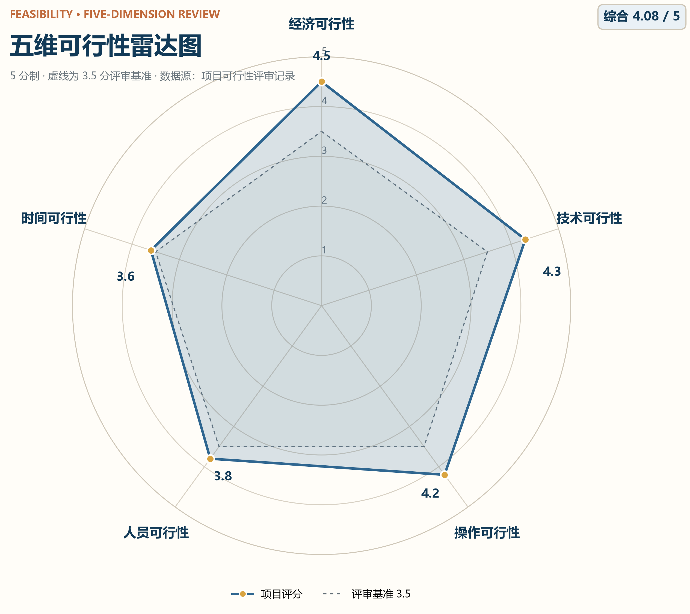

# 可行性分析报告

> 项目：筑测云 · 工程检测数据管理平台  
> 文档版本：v1.0  
> 日期：2026-11-06  
> 对应要求：作业要求第 2 条第（1）项——五维雷达图与可行性文档说明

## 1 分析目的与范围

本报告用于判断“筑测云”项目在课程大作业条件下是否值得立项，以及是否具备在限定周期内交付可运行 Demo 的条件。评估对象包括前端、后端、数据库、测试与工程文档，不包含真实检测设备接入、电子签章、等保测评与商业运营。

评估采用五维雷达图，维度为经济、技术、操作、人员和时间。每个维度采用 5 分制，3.5 分作为评审基准线：1 分表示不可行，3 分表示有条件可行，4 分表示可行，5 分表示明显优于课程要求。评分依据来自技术验证、环境实测和工期测算，属于课程项目口径的估算，不等同于商业项目评审。

## 2 五维评分结论

| 维度 | 评分 | 主要依据 | 结论 |
|---|---:|---|---|
| 经济可行性 | 4.5 | 采用开源技术栈，本地 SQLite，无云资源与商业授权费用 | 成本低，可承受 |
| 技术可行性 | 4.3 | FastAPI、SQLAlchemy、Vue 3、ECharts 均为成熟方案，已完成端到端验证 | 技术路径清晰 |
| 操作可行性 | 4.2 | B/S 架构免安装，角色与流程贴近检测业务，单命令启动 | 易演示、易培训 |
| 人员可行性 | 3.8 | 单人开发可完成，但需要同时承担需求、测试与文档；AI 可分担编码和图表工作 | 人员紧张但可控 |
| 时间可行性 | 3.6 | 8 周内完成全栈与文档，工期偏紧，需要冻结范围并保留缓冲 | 有压力但可交付 |
| **综合** | **4.08** | 五项均高于 3.5 分基准线 | **建议立项** |

雷达图显示经济与技术维度较强，人员与时间维度是短板。项目可行性成立，但必须坚持“Demo 范围”和“AI 产出必须经过人审”两个前提。

## 3 经济可行性

项目为课程大作业，不以盈利为目标。成本按教学口径估算，人力按机会成本折算，不含学生个人时间的全额市场薪酬。技术选型全部采用开源软件，数据库使用 SQLite 单文件，不产生服务器、对象存储和商业授权费用。

| 成本项 | 测算方式 | 估算金额（元） | 说明 |
|---|---|---:|---|
| 开发人力 | 15 人日 × 500 元/人日 | 7,500 | 需求、设计、编码、联调 |
| 测试与文档 | 5 人日 × 500 元/人日 | 2,500 | 接口测试、E2E、图表与报告 |
| 软件与资源 | 开源栈 + 本地运行 | 0 | 无商业授权与云主机 |
| 学习资料 | 一次性资料与打印 | 500 | 技术文档与规范资料 |
| 预备金 | 约 12% 风险缓冲 | 1,000 | 返工与演示风险 |
| **合计** |  | **11,500** | 课程 Demo 口径 |

收益主要体现在教学与能力训练：完整经历可行性、需求、设计、实现、测试、维护六个阶段；形成可复用的全栈模板；沉淀 AI 分级与失效评分方法。若后续转为真实产品，需要增加等保、电子签章、设备接入与运维成本，本报告不将其计入当前范围。

经济维度评分为 4.5 分。扣分项是人力机会成本仍然存在，且后续若要接入真实检测设备，硬件与合规成本会显著上升。

## 4 技术可行性

### 4.1 技术栈成熟度

| 层次 | 选型 | 成熟度 | 主要风险 | 应对措施 |
|---|---|---|---|---|
| 前端 | Vue 3 + Vite + Element Plus + ECharts | 高 | 依赖体积较大，首屏资源偏重 | 路由懒加载、构建产物由 FastAPI 托管 |
| 后端 | Python 3.12 + FastAPI + Pydantic v2 | 高 | 版本迭代快，需锁定依赖范围 | requirements.txt 约束主版本 |
| 数据访问 | SQLAlchemy 2.0 + Alembic | 高 | SQLite 并发写入能力有限 | Demo 单用户场景；生产可替换 PostgreSQL |
| 鉴权 | JWT + RBAC | 高 | 无状态令牌无法主动吊销 | 短周期令牌 + 停用账号校验；生产引入刷新令牌与黑名单 |
| 测试 | pytest + httpx + Edge + playwright-core | 高 | 浏览器版本差异 | 固定本机 Edge，E2E 独立执行 |
| 图表 | Matplotlib | 高 | 中文字体缺失会导致方框 | 显式指定微软雅黑并输出 PNG/SVG |

### 4.2 关键技术验证

- 已完成 56 个后端测试，全部通过，语句覆盖率 88%。
- 已使用真实 Edge 浏览器完成 10 个场景、12 张截图的端到端验证，覆盖登录、看板、项目增删、样品、检测判定预览、AI 监管和用户管理。
- 已验证自动判定在“实测值等于标准值”的边界下稳定，采用保留两位小数后比较，避免浮点误差。
- 已验证 Alembic 迁移、种子数据重建、JWT 鉴权、RBAC 越权拦截和统一异常响应。
- 已验证前端构建产物由 FastAPI 单进程托管，启动后可直接访问页面与 API 文档。

技术维度评分为 4.3 分。扣分项主要是 SQLite 并发限制和前端依赖体积；两者对课程 Demo 影响有限。

## 5 操作可行性

系统采用浏览器/服务器结构，用户无需安装客户端。检测工程师完成“项目—样品—检测记录”的日常录入，管理员维护用户与 AI 台账，查阅人员只读查看看板与记录。

| 操作场景 | 现有方式 | 系统方式 | 改进点 |
|---|---|---|---|
| 项目登记 | 表格分散、重复录入 | 项目台账统一维护 | 编号唯一、状态可见 |
| 样品管理 | 手工登记、易漏项 | 样品与项目关联 | 自动统计检测记录数 |
| 结果判定 | 人工比对标准值 | GTE/LTE 规则自动判定 | 降低计算错误 |
| 质量汇总 | 手工汇总 Excel | 看板实时汇总 | 减少重复劳动 |
| AI 协作管理 | 记录分散在对话中 | 任务台账 + 失效评分 | 可追溯、可复盘 |
| 用户权限 | 共用账号 | JWT + 三角色 | 最小权限 |

系统提供演示账号与种子数据，首次启动即可看到完整业务场景。对非技术用户，核心操作不超过三步：选择项目或样品、填写数值、保存查看结论。培训成本低，操作维度评分为 4.2 分。扣分项是 AI 监管页面概念较多，需要 10 分钟左右的讲解。

## 6 人员可行性

项目由 1 名开发者主导，AI Agent 承担脚手架、CRUD、图表、测试骨架与文档初稿等工作。人员能力要求与分工如下。

| 角色 | 职责 | 能力要求 | 本项目安排 |
|---|---|---|---|
| 项目负责人 | 范围、进度、验收 | 软件工程基础、沟通 | 开发者本人 |
| 检测业务顾问 | 判定规则、业务口径 | 土木工程检测知识 | 由开发者土木背景补足 |
| 开发与测试 | 前后端、数据库、测试 | Python、Vue、SQL | 开发者 + AI Agent |
| 评审与复核 | 需求基线、评分口径、验收 | 独立判断 | 指导教师 / 同学互评 |

人员维度的主要风险是“一人多角色”导致测试独立性不足，以及 AI 生成内容被直接采信。项目通过三条措施缓解：关键评分口径由人定稿；高失效任务强制人工复核；自动化测试与 E2E 作为客观门禁。人员维度评分为 3.8 分。

## 7 时间可行性

项目按 8 周排期，2026-09-14 至 2026-11-06。实际执行中，需求与架构在前期一次完成，后端与前端并行推进，最后两周集中测试、图表和文档。

| 周次 | 时间 | 主要任务 | 里程碑 |
|---|---|---|---|
| 第 1 周 | 09-14 至 09-20 | 选题、可行性、需求、用例 | 需求基线 |
| 第 2 周 | 09-21 至 09-27 | 总体设计、详细设计、数据库 | 架构与模型冻结 |
| 第 3 周 | 09-28 至 10-04 | 后端骨架、鉴权、项目与样品 | 核心 API 可用 |
| 第 4 周 | 10-05 至 10-11 | 检测记录、看板、AI 模块 | 业务闭环 |
| 第 5 周 | 10-12 至 10-18 | 前端页面、图表、联调 | 可演示页面 |
| 第 6 周 | 10-19 至 10-25 | 测试、E2E、缺陷修复 | 质量门禁通过 |
| 第 7 周 | 10-26 至 11-01 | 六类图表、维护复盘、文档 | 文档初稿 |
| 第 8 周 | 11-02 至 11-06 | Word 总报告、答辩准备、终验 | 最终交付 |

时间维度评分为 3.6 分。扣分项是文档与图表工作量被低估，且 AI 生成内容需要返工。应对策略是冻结范围、优先保证可运行闭环、把非核心功能列为范围外。

## 8 风险综合评估

| 风险 | 概率 | 影响 | 等级 | 应对策略 |
|---|---|---|---|---|
| AI 生成代码存在字段或契约错误 | 高 | 中 | 高 | 契约先行、自动化测试、E2E 回归 |
| 需求范围膨胀 | 中 | 高 | 高 | 冻结 Demo 范围，新增需求进入待办 |
| 工期不足 | 中 | 高 | 高 | 8 周排期 + 最后一周缓冲，文档模板化 |
| SQLite 并发与备份 | 低 | 中 | 中 | 单用户演示；定期复制 app.db |
| 浏览器与图表渲染差异 | 低 | 低 | 低 | 固定 Edge 验证，空数据兜底 |
| 评分口径主观 | 中 | 中 | 中 | 五维锚点、双人复核、阈值校准 |

## 9 结论

项目在经济、技术、操作、人员和时间五个维度均超过 3.5 分基准线，综合评分 4.08 分，具备立项条件。建议按“可运行 Demo + 工程文档 + AI 治理机制”的范围推进，不扩展到真实设备接入、电子签章和生产级高可用。

立项条件如下：

1. 业务范围冻结为项目管理、样品管理、检测记录与 AI 协作监管四类核心能力。
2. 数据库采用 SQLite，生产化替换方案写入总体设计，不在本期实施。
3. 所有 AI 产出必须通过自动门禁或人工复核，高失效任务不得直接进入交付物。
4. 保留最后一周作为测试、文档与答辩缓冲。

综上，本项目可行。
