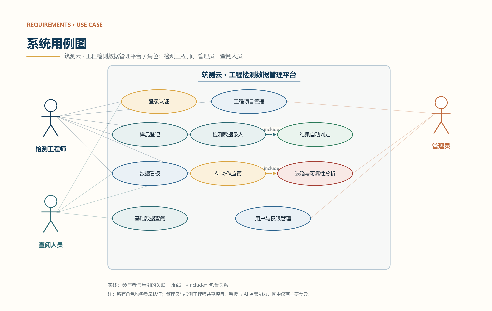

# 需求规格说明书

> 项目：筑测云 · 工程检测数据管理平台  
> 文档版本：v1.0  
> 日期：2026-11-06  
> 对应要求：作业要求第 2 条第（2）项——用例图与需求文档（用户需求与开发需求）

## 1 文档目的与范围

本文档定义“筑测云”Demo 系统的用户需求、开发需求与验收标准，作为设计、实现、测试和验收的共同基线。系统面向施工项目部与中小检测机构的检测数据管理场景，覆盖工程项目、检测样品、检测记录、自动判定、数据看板以及 AI 协作监管。

本期范围限定为可运行的 Web Demo：前端、后端、数据库、测试与文档均需交付；不包含真实检测设备接入、电子签章、报告对外出具、多租户计费与生产级高可用。

## 2 术语与缩略语

| 术语 | 含义 |
|---|---|
| 工程项目 | 检测合同对应的建设项目，是样品与检测记录的顶层归属 |
| 检测样品 | 进入检测流程的混凝土试块、钢筋、土工、砂浆或沥青样品 |
| 检测记录 | 某个样品的一次检测结果，包含检测项目、标准值、实测值与结论 |
| GTE | Greater Than or Equal，实测值应大于等于标准值 |
| LTE | Less Than or Equal，实测值应小于等于标准值 |
| Agent | 参与软件开发或系统监管的 AI 智能体 |
| FS | Failure Score，Agent 失效率评分，0～100 分，越高越不可靠 |
| RBAC | 基于角色的访问控制 |
| P0 / P1 / P2 | 需求优先级：必须实现 / 应当实现 / 可选实现 |

## 3 利益相关者与角色

| 角色 | 主要诉求 | 系统权限 |
|---|---|---|
| 检测工程师 | 快速登记样品、录入检测数据、获得自动判定结果 | 项目、样品、检测记录的读写；看板与 AI 监管只读 |
| 管理员 | 维护账号与权限、纠错、监管 AI 任务与缺陷 | 全部业务读写、用户管理、AI 台账管理 |
| 查阅人员 | 只读查看项目、样品、检测结果与质量看板 | 只读；不能新增、修改、删除业务数据 |
| 指导教师 / 评审人 | 检查工程过程、文档与可运行性 | 使用管理员账号演示，不参与日常业务 |
| 开发者 / AI Agent | 按需求实现、测试、生成图表与文档 | 通过代码与脚本操作，不直接拥有业务账号 |

角色采用最小权限原则。前端按角色隐藏操作入口，后端仍以 JWT + RBAC 强制校验，不能只依赖前端隐藏。

## 4 用户需求

### 4.1 用户画像与典型场景

- **李工（检测工程师）**：每天需要登记多个项目送来的试块与钢筋样品，录入抗压强度、屈服强度等实测值，希望系统自动判断合格与否，避免手工查标准表。
- **赵管理员**：负责账号、项目与数据纠错，同时需要检查 AI 生成的任务是否可靠，哪些缺陷需要优先修复。
- **王审阅（查阅人员）**：关注项目整体合格率与最近检测记录，不需要修改数据。

典型业务链路为：登录、选择项目、登记样品、录入检测数据、系统自动判定、看板汇总，最后由管理员查看 AI 可靠性并安排维护。

### 4.2 用户故事

| 编号 | 角色 | 用户故事 | 价值 | 优先级 |
|---|---|---|---|---|
| US-01 | 全部 | 作为用户，我希望用账号密码登录，以便进入与角色匹配的工作台 | 身份识别与数据隔离 | P0 |
| US-02 | 全部 | 作为用户，我希望登录失效时得到明确提示，以便重新登录 | 减少操作困惑 | P0 |
| US-03 | 管理员 | 作为管理员，我希望维护用户与角色，以便控制访问范围 | 权限治理 | P0 |
| US-04 | 工程师 | 作为工程师，我希望按编号、名称、状态筛选项目，以便快速定位工程 | 提升检索效率 | P0 |
| US-05 | 工程师 | 作为工程师，我希望新建和修改项目，以便维护项目台账 | 数据完整性 | P0 |
| US-06 | 工程师 | 作为工程师，我希望登记样品并关联项目，以便形成检测对象 | 业务闭环 | P0 |
| US-07 | 工程师 | 作为工程师，我希望录入检测项目、标准值、实测值与判定规则，以便自动得到结论 | 降低计算错误 | P0 |
| US-08 | 工程师 | 作为工程师，我希望判定支持 GTE 与 LTE，以便覆盖强度下限和含水率上限两类指标 | 规则完整性 | P0 |
| US-09 | 工程师 | 作为工程师，我希望在保存前看到判定预览，以便发现录入错误 | 减少返工 | P1 |
| US-10 | 工程师 | 作为工程师，我希望按项目、结论、日期筛选检测记录，以便追溯历史 | 可追溯性 | P1 |
| US-11 | 全部 | 作为用户，我希望在看板看到合格率、趋势和分布，以便快速判断质量态势 | 决策支持 | P0 |
| US-12 | 管理员 | 作为管理员，我希望登记 AI 任务的五维评分，以便量化 Agent 失效程度 | AI 可靠性治理 | P0 |
| US-13 | 管理员 | 作为管理员，我希望查看各阶段可靠性、高失效任务和缺陷帕累托，以便安排维护 | 维护决策 | P0 |
| US-14 | 全部 | 作为用户，我希望看到 L1/L2/L3 分级机制与升级规则，以便理解人机分工 | 过程透明 | P1 |
| US-15 | 管理员 | 作为管理员，我希望被系统阻止停用自己或降级自己，以免失去管理入口 | 安全兜底 | P1 |
| US-16 | 全部 | 作为用户，我希望系统提供演示数据，以便首次打开即可理解业务 | 降低演示成本 | P1 |

## 5 用例模型

### 5.1 用例图

图中实线表示参与者与用例的关联，虚线表示 `«include»` 包含关系。为保证可读性，图中只画主要差异；所有角色均需登录认证，管理员与检测工程师共享项目、看板与 AI 监管能力，详细权限以第 6.1 节功能需求为准。

### 5.2 用例清单

| 编号 | 用例 | 主要参与者 | 前置条件 | 结果 |
|---|---|---|---|---|
| UC-01 | 登录认证 | 全部角色 | 拥有启用账号 | 获得 JWT，进入工作台 |
| UC-02 | 用户与权限管理 | 管理员 | 已登录且为管理员 | 账号、角色、状态被维护 |
| UC-03 | 工程项目管理 | 管理员、工程师 | 已登录且具备编辑权限 | 项目新增、修改、删除或查询 |
| UC-04 | 样品登记 | 管理员、工程师 | 项目存在 | 样品与项目关联 |
| UC-05 | 检测数据录入与自动判定 | 管理员、工程师 | 样品存在、参数合法 | 生成 PASS/FAIL 记录 |
| UC-06 | 数据看板 | 全部角色 | 已登录 | 展示 KPI 与图表 |
| UC-07 | AI 任务台账 | 管理员可写，其他只读 | 已登录 | 任务登记、评分、查询 |
| UC-08 | 缺陷与可靠性分析 | 全部角色，管理员可写 | 已登录 | Pareto、可靠性、失效案例 |
| UC-09 | AI 分级机制查阅 | 全部角色 | 已登录 | 查看 L1/L2/L3 与升级规则 |

### 5.3 核心用例描述

#### UC-05 检测数据录入与自动判定

| 项目 | 内容 |
|---|---|
| 参与者 | 检测工程师（主）、管理员 |
| 前置条件 | 已登录；样品存在；具备编辑权限 |
| 触发条件 | 用户在检测记录页点击“录入检测”并提交 |
| 主成功流 | 1. 用户选择样品，填写检测项目、标准值、实测值、单位与规则。 2. 前端实时预览判定结果。 3. 用户提交，系统校验 JWT 与角色。 4. 系统校验样品存在与参数合法性。 5. 系统将标准值与实测值保留两位小数后比较。 6. 按 GTE 或 LTE 生成 PASS/FAIL。 7. 保存记录，将样品状态置为 DONE。 8. 返回统一响应，页面与看板刷新。 |
| 异常流 | 未登录或角色不符返回 401/403；样品不存在返回 40002；参数校验失败返回 42201；服务异常返回 50000。 |
| 后置条件 | 检测记录持久化；样品状态更新；列表与看板可见。 |
| 验收标准 | 实测值等于标准值时按规则稳定判定；31 ≥ 30 为合格，29.99 < 30 为不合格；LTE 反之。 |

#### UC-07 AI 任务台账

| 项目 | 内容 |
|---|---|
| 参与者 | 管理员（写）、其他角色（读） |
| 前置条件 | 已登录；写操作需要管理员角色 |
| 主成功流 | 1. 管理员登记任务名称、阶段、Agent、等级、状态与五维评分。 2. 系统按权重计算失效分 FS 与失效等级。 3. 记录保存并出现在台账。 4. 概览页按阶段聚合可靠性，筛出 FS ≥ 40 的案例。 5. 管理员根据阈值决定复核、重做或升级。 |
| 异常流 | 维度分超出 0～5 返回 422；非管理员写入返回 403。 |
| 后置条件 | 任务可追溯；统计接口与看板同步更新。 |
| 验收标准 | FS = 20 × (25C + 20I + 25R + 15M + 15S) / 100；全 5 分得 100，全 0 分得 0。 |

#### UC-08 缺陷与可靠性分析

| 项目 | 内容 |
|---|---|
| 参与者 | 全部角色；管理员可写 |
| 前置条件 | 已登录；存在缺陷或任务数据 |
| 主成功流 | 1. 系统按缺陷分类汇总发生次数并降序排列。 2. 计算每一类的占比与累计占比。 3. 绘制帕累托图并标出 80% 参考线。 4. 按阶段计算平均失效分与综合可靠性。 5. 展示高失效任务、严重度分布和待修复数量。 |
| 后置条件 | 维护报告可引用同一口径的数据。 |
| 验收标准 | 累计占比最终为 100%；分类降序；80% 线位置与数据一致。 |

## 6 开发需求

### 6.1 功能需求

| 编号 | 模块 | 需求描述 | 优先级 | 验收要点 |
|---|---|---|---|---|
| FR-AUTH-01 | 认证 | 使用用户名与密码登录，成功后签发 JWT | P0 | 正确凭据返回令牌；错误凭据统一提示“用户名或密码错误” |
| FR-AUTH-02 | 认证 | 提供当前用户查询与退出接口 | P0 | `GET /api/auth/me` 返回角色；退出清理本地令牌 |
| FR-AUTH-03 | 认证 | 角色分为管理员、检测工程师、查阅人员 | P0 | 越权写操作返回 403 |
| FR-USER-01 | 用户 | 管理员分页查询、创建、修改用户角色与状态 | P0 | 重复登录名返回 409；不能停用或降级自己 |
| FR-PROJ-01 | 项目 | 项目分页列表，支持关键字与状态筛选 | P0 | 返回总数、页码、样品数 |
| FR-PROJ-02 | 项目 | 新建与修改项目，编号唯一，结束日期不得早于开始日期 | P0 | 重复编号 409；日期错误 422 |
| FR-PROJ-03 | 项目 | 删除项目；存在样品时拒绝 | P0 | 返回 40005 |
| FR-SAMP-01 | 样品 | 样品分页列表，支持项目、类型、状态、关键字筛选 | P0 | 关联项目名称与检测记录数 |
| FR-SAMP-02 | 样品 | 登记与修改样品，必须关联已存在项目，编号唯一 | P0 | 项目不存在 40002；编号重复 409 |
| FR-SAMP-03 | 样品 | 删除样品；存在检测记录时拒绝 | P0 | 返回 40006 |
| FR-TEST-01 | 检测 | 录入检测记录，按 GTE/LTE 自动判定 | P0 | 保留两位小数比较；返回 PASS/FAIL |
| FR-TEST-02 | 检测 | 修正记录后重新判定 | P1 | 修改实测值后结论同步变化 |
| FR-TEST-03 | 检测 | 检测记录分页与多条件筛选 | P0 | 支持项目、样品、结论、日期、关键字 |
| FR-TEST-04 | 检测 | 删除检测记录仅管理员可操作 | P1 | 非管理员 403 |
| FR-TEST-05 | 检测 | 新增记录后将样品状态置为 DONE | P1 | 样品详情状态同步 |
| FR-DASH-01 | 看板 | 展示项目、样品、检测、合格率、可靠性 KPI | P0 | 与数据库统计一致 |
| FR-DASH-02 | 看板 | 展示近六个月趋势、类型合格率、项目状态、样品构成、缺陷分类 | P0 | 空数据不报错 |
| FR-AI-01 | AI 监管 | AI 任务台账分页、筛选、增删改 | P0 | 非管理员只读；评分自动计算 |
| FR-AI-02 | AI 监管 | 五维失效评分与失效等级 | P0 | 公式、阈值、标签一致 |
| FR-AI-03 | AI 监管 | 缺陷台账增删改查，按阶段、分类、严重度、状态筛选 | P0 | 发生次数累计正确 |
| FR-AI-04 | AI 监管 | 统计各阶段可靠性、等级分布、失效案例与缺陷帕累托 | P0 | 与台账数据一致 |
| FR-AI-05 | AI 监管 | 提供 L1/L2/L3 分级机制与升级规则 | P1 | 六个阶段的任务拆分完整 |
| FR-COMMON-01 | 通用 | 统一响应包与全局异常处理 | P0 | 成功 `code=0`；失败包含 `code` 与 `message` |
| FR-COMMON-02 | 通用 | 列表接口统一分页参数 | P1 | `page`、`page_size` 校验与边界处理 |

### 6.2 非功能需求

| 编号 | 类别 | 指标 | 验收方式 |
|---|---|---|---|
| NFR-PERF-01 | 性能 | 本地环境常规查询 P95 ≤ 500 ms；首屏 ≤ 3 s | 本地实测与浏览器 E2E |
| NFR-PERF-02 | 性能 | 演示数据规模下列表分页响应 ≤ 1 s | 60 条检测记录实测 |
| NFR-SEC-01 | 安全 | 密码使用 PBKDF2-HMAC-SHA256，迭代 260,000 次，加盐存储 | 代码审查 |
| NFR-SEC-02 | 安全 | JWT 有效期 720 分钟，签名算法 HS256 | 配置与测试 |
| NFR-SEC-03 | 安全 | 写操作按角色校验，前端隐藏不作为唯一防线 | 权限测试 7 项 |
| NFR-SEC-04 | 安全 | 前端不保存密码；退出清理令牌；CORS 限定本地源 | 代码审查与 E2E |
| NFR-REL-01 | 可靠性 | 后端自动化测试全部通过，语句覆盖率 ≥ 80% | pytest + coverage，实测 88% |
| NFR-REL-02 | 可靠性 | 数据库支持迁移与重建；异常不暴露堆栈给前端 | Alembic、全局异常测试 |
| NFR-USE-01 | 易用性 | 中文界面；核心业务三步内完成；关键操作有成功提示 | 人工走查与截图 |
| NFR-USE-02 | 易用性 | 空数据、无权限、未登录都有明确提示 | 空状态与异常用例 |
| NFR-MAIN-01 | 可维护性 | 后端模块自动发现；Schema、Service、Router 分层 | 目录结构与代码审查 |
| NFR-MAIN-02 | 可维护性 | 关键算法、错误码、接口与文档保持一致 | 文档核对与测试 |
| NFR-COMPAT-01 | 兼容性 | 支持 Edge / Chrome 现代版本；Python 3.12；Node 24 | 本机实测 |
| NFR-AUDIT-01 | 可追溯 | AI 任务保留五维评分、失效分、重试、人工耗时与备注 | 台账查询与统计 |

### 6.3 数据需求

系统包含 6 张表：用户、项目、样品、检测记录、AI 任务、缺陷。演示数据规模为 4 个账号、6 个项目、24 个样品、60 条检测记录、24 条 AI 任务、25 条缺陷记录（累计发生 68 次）。数据时间覆盖 2026 年 6 月至 11 月，保证看板趋势有六个月数据。

数据质量规则：

1. 项目编号、样品编号、登录名唯一。
2. 样品必须关联已存在的项目；检测记录必须关联样品与检测人。
3. 标准值与实测值为正数，判定前保留两位小数。
4. 枚举值限定在既定集合内，前后端共用同一套标签。
5. 删除父记录前检查子记录，避免孤儿数据；SQLite 开启外键约束。
6. 种子数据可重复构建，`seed.py --reset` 后统计口径稳定。

### 6.4 接口需求

接口采用 REST 风格，统一前缀 `/api`，请求与响应为 JSON。除登录与健康检查外，均需携带 `Authorization: Bearer <token>`。成功响应为 `{code: 0, message: "ok", data: ...}`；业务失败返回非 0 错误码与可读消息，HTTP 状态码同步表达语义。

完整接口清单、请求字段与错误码见《04 详细设计说明书》。系统共 20 个路径、34 个操作，覆盖认证、用户、项目、样品、检测、看板与 AI 监管。

### 6.5 约束与假设

- 运行环境为 Windows 本地，Python 与 Node 依赖安装在项目工作区内，不写入系统目录。
- 前端构建产物由 FastAPI 托管，部署为单进程；开发期使用 Vite 代理。
- 数据库使用 SQLite 单文件，不要求多实例并发写入。
- 系统不依赖外部网络服务；图表在本地生成，字体使用系统微软雅黑。
- AI 产出需要人工复核，系统记录评分与复盘，但不自动修改业务数据。

### 6.6 范围外事项

真实检测设备接入、电子签章、对外报告出具、附件上传、短信通知、多租户与计费、生产级高可用、刷新令牌与令牌黑名单、移动端原生应用。上述内容在总体设计中给出演进建议，不在本期实现。

## 7 验收标准与追踪

### 7.1 验收场景

| 编号 | 验收场景 | 预期结果 |
|---|---|---|
| AC-01 | 管理员、工程师、查阅人员分别登录并访问受限接口 | 角色权限正确，越权返回 403 |
| AC-02 | 新建项目、修改状态、删除有样品项目 | 创建成功、修改生效、删除被拒绝 |
| AC-03 | 登记样品并删除有检测记录的样品 | 登记成功，删除返回 40006 |
| AC-04 | 录入 30/30、30/29.99、LTE 边界数据 | 判定符合规则，边界稳定 |
| AC-05 | 看板 KPI 与数据库统计核对 | 项目 6、样品 24、记录 60、合格率 85.0% |
| AC-06 | AI 任务登记与统计 | FS 公式正确；可靠性 85.3；高失效 4 项 |
| AC-07 | 缺陷帕累托 | 25 条记录、68 次发生，累计 100%，80% 线正确 |
| AC-08 | 自动化与端到端验证 | 56 个 pytest 全通过；Edge E2E 12 张截图无错误 |
| AC-09 | 文档与图表 | 六类图表齐全，Word 总报告可打开 |

### 7.2 需求追踪矩阵

| 需求组 | 后端模块 | 前端页面 | 验证用例 |
|---|---|---|---|
| FR-AUTH / FR-USER | `auth`、`users` | 登录、用户管理 | `test_auth.py`、`test_permissions.py` |
| FR-PROJ | `projects` | 工程项目 | `test_projects.py` |
| FR-SAMP | `samples` | 检测样品 | `test_samples_records.py` |
| FR-TEST | `test_records` | 检测记录 | `test_samples_records.py` |
| FR-DASH | `dashboard` | 数据看板 | `test_dashboard_ai.py` |
| FR-AI | `ai_ops` | AI 协作监管 | `test_dashboard_ai.py` |
| FR-COMMON | `core`、`db` | Axios 拦截器 | `test_http_errors.py` |
| NFR-SEC | `core/security.py`、`core/deps.py` | 路由守卫 | 权限测试 |
| NFR-REL | `tests`、E2E 脚本 | 全站 | pytest、Edge E2E |

## 8 需求变更管理

需求基线以本文档 v1.0 为准。变更流程如下：

1. 提出变更申请，说明原因与期望结果。
2. 评估对数据模型、接口、测试与文档的影响。
3. 更新需求条目与追踪矩阵。
4. 实现并回归。
5. 在维护记录中登记。

未完成评估的变更不进入开发，避免范围膨胀。

本期已知的待改进需求包括：检测记录重复提交拦截、错误码与前端提示的完整映射、AI 评分锚点的进一步细化。这三项已在缺陷台账中登记，属于维护阶段任务。
