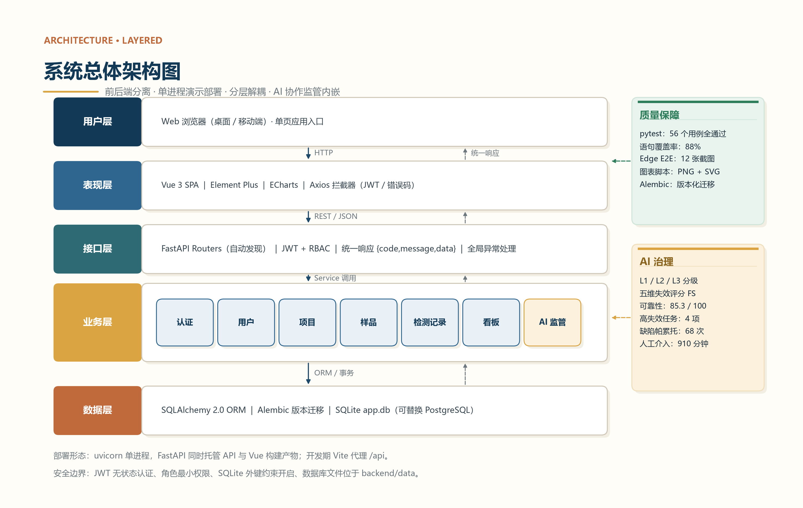

# 总体设计说明书

> 项目：筑测云 · 工程检测数据管理平台  
> 文档版本：v1.0  
> 日期：2026-11-06  
> 对应要求：作业要求第 2 条第（3）项——系统架构图与总体架构说明文档

## 1 设计目标与原则

系统面向课程大作业交付，目标是在有限周期内形成一个“可运行、可演示、可追溯”的全栈闭环，并把 AI 协作治理作为一等模块，而不是只写在文档里。设计遵循以下原则。

1. **业务闭环优先**：先保证项目、样品、检测、看板与用户管理可用，再补充 AI 监管细节。
2. **分层与模块化**：前端视图、接口层、业务服务、数据访问与数据库分层；后端模块自动发现，减少入口文件耦合。
3. **契约先行**：统一响应包、统一错误码、统一分页参数，前后端按同一契约联调。
4. **权限最小化**：前端隐藏入口，后端强制校验；管理员关键操作有自保护。
5. **AI 产出可追溯**：AI 任务保留分级、五维评分、失效分、人工耗时与复盘备注，可靠性可以计算和复查。
6. **演示零依赖**：SQLite 单文件、静态资源由后端托管、单命令启动，不依赖外部云服务。

非目标：生产级高并发、多租户、电子签章、真实设备接入。相关内容在演进路线中说明。

## 2 系统架构



系统采用前后端分离的分层架构，演示环境由 FastAPI 单进程托管 API 与前端构建产物。浏览器通过 HTTP 访问页面，页面使用 Axios 调用 `/api`，后端完成鉴权、参数校验、业务处理与数据持久化。

| 层次 | 组成 | 职责 |
|---|---|---|
| 用户层 | Web 浏览器、桌面与移动端 | 访问页面，无需安装客户端 |
| 表现层 | Vue 3、Element Plus、ECharts、Axios | 渲染页面、图表与交互；统一注入 JWT；处理错误提示 |
| 接口层 | FastAPI Routers、JWT/RBAC、统一响应与异常 | 路由、鉴权、参数校验、响应封装、OpenAPI 文档 |
| 业务层 | 认证、用户、项目、样品、检测、看板、AI 监管 | 业务规则、自动判定、统计聚合、评分计算 |
| 数据层 | SQLAlchemy 2.0、Alembic、SQLite | ORM 映射、迁移、事务与持久化 |
| 质量保障 | pytest、httpx、Edge + playwright-core、Matplotlib | 接口测试、端到端验证、图表生成 |
| AI 治理 | 任务台账、缺陷台账、失效评分、可靠性统计 | 分级管理、失效复盘、维护决策支持 |

### 2.1 后端模块自动发现

`app/modules/__init__.py` 使用 `pkgutil` 扫描 `app/modules` 下的子包，导入每个子包的 `router.py` 并注册到应用。新增业务模块只需创建目录、模型、Schema、Service 与 Router，无需修改 `main.py`。当前自动注册 7 个模块。

模型导入同样由 `import_all_models()` 完成，保证 Alembic 与建表时元数据完整。该机制降低了模块间耦合，也让测试可以独立导入模型。

### 2.2 前端结构

前端采用 Vue 3 单页应用与 hash 路由，构建产物输出到 `backend/app/static`。页面通过布局组件复用侧边栏、顶栏与用户菜单；图表统一由 `ChartPanel` 封装 ECharts 初始化、更新与销毁；状态标签由 `StatusPill` 统一映射颜色与中文标签。

## 3 技术选型

| 层次 | 选择 | 理由 | 备选与取舍 |
|---|---|---|---|
| 前端框架 | Vue 3 + Vite | 组合式 API、构建快、生态成熟 | React 也可行，但团队更熟悉 Vue |
| UI 组件 | Element Plus | 表格、表单、弹窗、分页齐全 | 原生组件工作量大，Ant Design Vue 体积相近 |
| 图表 | ECharts | 中文生态好，支持折线、柱状、环形与帕累托组合 | Chart.js 对复杂图表支持较弱 |
| 后端框架 | FastAPI | 类型友好、OpenAPI 自动生成、性能足够 | Flask 需要自行补校验与文档 |
| 数据访问 | SQLAlchemy 2.0 + Alembic | 现代 ORM、迁移版本化 | 原生 SQL 可读但维护成本高 |
| 数据库 | SQLite | 零部署、单文件、适合 Demo | PostgreSQL 更适合生产，已预留替换路径 |
| 鉴权 | JWT + RBAC | 无状态、前后端分离友好 | Session 需要服务端存储与 Cookie 策略 |
| 测试 | pytest + httpx + playwright-core | 接口与真实浏览器双层验证 | 只做接口测试无法发现渲染问题 |
| 图表文档 | Matplotlib | 中文支持好，可输出 PNG/SVG | 手绘或在线工具不可复现 |

## 4 模块设计

### 4.1 后端模块

| 模块 | 主要职责 | 主要接口 |
|---|---|---|
| `auth` | 登录、当前用户、退出 | `POST /api/auth/login`、`GET /api/auth/me`、`POST /api/auth/logout` |
| `users` | 用户分页、新增、角色与状态维护 | `GET/POST /api/users`、`PATCH /api/users/{id}` |
| `projects` | 项目 CRUD、筛选、下拉选项 | `GET/POST /api/projects`、`PUT/DELETE /api/projects/{id}` |
| `samples` | 样品 CRUD、项目与类型筛选 | `GET/POST /api/samples`、`PUT/DELETE /api/samples/{id}` |
| `test_records` | 检测记录 CRUD、自动判定、日期筛选 | `GET/POST /api/test-records`、`PUT/DELETE /api/test-records/{id}` |
| `dashboard` | KPI、趋势、分布、合格率、最近记录 | `GET /api/dashboard/overview` |
| `ai_ops` | AI 任务、缺陷、评分、可靠性、分级配置 | `/api/ai/tasks`、`/api/ai/defects`、`/api/ai/stats`、`/api/ai/grading` |
| `core` | 配置、安全、依赖、异常、统一响应 | 被各模块复用 |
| `db` | 基类、会话、SQLite 外键开关 | 被各模块复用 |

业务层按“Router 负责协议、Service 负责规则、Model 负责持久化、Schema 负责校验”的方式组织。路由不直接拼 SQL，Service 不依赖 FastAPI 请求对象，便于测试。

### 4.2 前端页面

| 页面 | 路由 | 主要能力 |
|---|---|---|
| 登录 | `/login` | 账号密码登录、演示账号填充、错误提示 |
| 数据看板 | `/dashboard` | KPI、六月趋势、类型合格率、状态分布、缺陷 TOP、AI 快照、最近记录 |
| 工程项目 | `/projects` | 筛选、分页、新建、编辑、删除、状态标签 |
| 检测样品 | `/samples` | 按项目、类型、状态筛选；登记与编辑 |
| 检测记录 | `/test-records` | 筛选、录入、判定预览、修正、删除 |
| AI 协作监管 | `/ai-ops` | 可靠性总览、任务台账、缺陷帕累托、分级机制 |
| 用户管理 | `/users` | 管理员维护账号、角色、状态与密码 |

### 4.3 复用组件

- `AppLayout`：侧边栏、顶栏、用户菜单、AI 可靠性概览。
- `ChartPanel`：ECharts 生命周期与响应式调整，空数据占位。
- `StatCard`：KPI 卡片，支持色调与图标。
- `StatusPill`：角色、项目状态、样品类型、结论、AI 等级、失效等级等标签统一映射。
- `http.js`：Axios 实例，注入令牌，统一处理业务码与 401。

## 5 部署架构

### 5.1 演示部署

演示模式为单进程：FastAPI 监听 `127.0.0.1:8000`，同时提供 `/api` 与前端静态资源。数据库文件位于 `backend/data/app.db`，启动脚本先执行 Alembic 迁移，再在数据库为空时写入种子数据。

启动流程：

1. 检查虚拟环境与端口占用。
2. 执行 `alembic upgrade head`。
3. 执行 `seed.py`；已有数据时跳过，不覆盖演示记录。
4. 启动 uvicorn，写入真实监听 PID 到 `.run/server.pid`。
5. 访问 `http://127.0.0.1:8000`，API 文档位于 `/api/docs`。

停止脚本读取 PID 文件，并通过端口监听进程比对，确认 PID 一致后才停止，避免误杀其他进程。日志写入 `.run/server.log` 与 `.run/server.err.log`。

### 5.2 开发部署

开发期可分别启动后端与前端：后端使用 uvicorn 监听 8000；前端使用 Vite 监听 5173，并把 `/api` 代理到 8000。修改前端代码后热更新，修改后端代码后重启 uvicorn。提交或演示前执行 `npm run build`，将产物写入后端静态目录。

### 5.3 数据库与外键

SQLite 连接建立时执行 `PRAGMA foreign_keys=ON`。样品对项目、检测记录对样品与用户使用 `ON DELETE RESTRICT`，Service 层同时做关联计数校验，形成双重保护。数据库文件不进入前端静态目录，避免被直接下载。

## 6 关键运行流程

### 6.1 登录与鉴权

1. 用户提交用户名与密码。
2. 后端按用户名查询账号，校验 PBKDF2 哈希；错误统一返回“用户名或密码错误”，避免账号枚举。
3. 账号停用时返回 403；成功时更新最近登录时间并签发 JWT。
4. 前端保存令牌，后续请求通过 Axios 拦截器添加 `Authorization` 头。
5. 后端依赖解析令牌、查询用户并校验角色；失效令牌返回 401，前端清理并跳转登录。

### 6.2 检测记录与自动判定

1. 工程师选择样品并填写检测项目、标准值、实测值、单位与规则。
2. 前端实时预览判定，提示可能的结果。
3. 提交后后端校验 JWT、角色、样品存在与参数范围。
4. Service 将两个数值保留两位小数，按 GTE 或 LTE 比较，生成 PASS/FAIL。
5. 保存记录并将样品状态置为 DONE，返回统一响应。
6. 前端刷新列表，看板下次加载时读取最新统计。

### 6.3 AI 可靠性统计

1. 管理员登记任务，选择阶段、等级、Agent、状态，并填写五维失效率评分。
2. 后端按权重计算 FS，写入任务表。
3. 统计接口按阶段聚合平均 FS、一次通过率与综合可靠性。
4. 缺陷表按分类汇总发生次数，计算占比与累计占比，生成帕累托数据。
5. 前端在 AI 监管页展示可靠性、失效案例与帕累托图，维护文档引用同一口径。

## 7 数据库总体设计

系统共 6 张表：`users`、`projects`、`samples`、`test_records`、`ai_tasks`、`defects`。前四张表构成业务主链，后两张表构成 AI 治理台账。

| 表 | 作用 | 关键约束 |
|---|---|---|
| `users` | 账号与角色 | 登录名唯一；角色枚举；停用状态 |
| `projects` | 工程项目 | 编号唯一；日期范围校验 |
| `samples` | 检测样品 | 编号唯一；外键指向项目 |
| `test_records` | 检测记录 | 外键指向样品与检测人；结论枚举 |
| `ai_tasks` | AI 任务台账 | 五维评分 0～5；FS 0～100 |
| `defects` | 缺陷台账 | 分类、严重度、发生次数、AI 相关标记 |

完整字段、类型、ER 图与索引说明见《04 详细设计说明书》。

## 8 接口与响应规范

### 8.1 统一响应包

成功响应：

```json
{"code": 0, "message": "ok", "data": {}}
```

业务失败响应：

```json
{"code": 40006, "message": "样品下存在检测记录，无法删除", "data": null}
```

HTTP 状态码与业务码同时表达语义：401 表示未登录或令牌失效，403 表示无权限，404 表示资源不存在，409 表示唯一约束冲突，422 表示参数校验失败，500 表示未预期异常。前端 Axios 拦截器读取 `message` 展示提示；401 时清理本地令牌并跳转登录。

### 8.2 分页与筛选

列表接口统一使用 `page` 与 `page_size`，`page_size` 最大 100。返回 `items`、`total`、`page`、`page_size`、`pages`。筛选参数按模块定义，例如项目支持 `q` 与 `status`，检测记录支持 `project_id`、`sample_id`、`conclusion`、`start_date`、`end_date`。

### 8.3 文档与调试

FastAPI 自动生成 OpenAPI 文档，访问 `/api/docs` 可直接调试。接口文档与本文档、README 保持同一路径口径，避免端口和前缀不一致。

## 9 安全设计

| 风险 | 控制措施 | 残留风险 |
|---|---|---|
| 密码泄露 | PBKDF2-HMAC-SHA256，随机盐，260,000 次迭代 | 演示账号密码公开，仅限本地 |
| 越权操作 | JWT + RBAC，后端依赖校验，前端路由守卫 | 无刷新令牌与吊销列表 |
| 管理员误操作 | 不能停用或降级当前账号 | 多管理员场景需额外审计 |
| SQL 注入 | SQLAlchemy 参数化查询 | 原生 SQL 需单独审查 |
| 跨域滥用 | CORS 限定本地开发与演示地址 | 生产需精确域名与 HTTPS |
| 令牌存储 | 前端 localStorage，退出清理 | XSS 风险；生产建议 HttpOnly Cookie |
| 敏感配置 | 密钥通过 `ZHCE_SECRET_KEY` 覆盖 | 默认演示密钥不能用于生产 |

## 10 非功能设计

- **性能**：列表分页、数据库索引、前端路由懒加载；演示规模下查询稳定。ECharts 按需初始化并在组件销毁时释放。
- **可靠性**：统一异常处理避免堆栈外泄；Alembic 迁移；种子数据可重建；测试覆盖认证、权限、CRUD、边界与统计。
- **可维护性**：模块自动发现、分层结构、统一命名；文档与代码共用枚举和统计口径；图表脚本可重复生成。
- **易用性**：中文界面、明确空状态、表单校验、操作成功提示；核心业务不超过三步。
- **可观测性**：uvicorn 访问日志、启动日志与错误日志；测试输出与 E2E 截图作为质量证据。
- **兼容性**：Edge / Chrome 现代版本，Windows 本地运行，Python 3.12，Node 24。

## 11 目录结构

```text
HomeWork/
├─ backend/                 FastAPI 应用、迁移、种子与测试
│  ├─ app/
│  │  ├─ core/              配置、安全、异常、依赖、枚举
│  │  ├─ db/                基类、会话、SQLite 外键
│  │  ├─ modules/           七个业务模块（自动发现）
│  │  └─ static/            Vue 构建产物
│  ├─ alembic/              迁移脚本
│  ├─ tests/                56 个 pytest 用例
│  ├─ data/app.db           SQLite 数据库
│  ├─ seed.py               演示数据
│  └─ requirements.txt
├─ frontend/                Vue 3 源码与 E2E 脚本
│  ├─ src/                  视图、组件、API、样式
│  ├─ e2e/ui-check.mjs      Edge 端到端验证
│  └─ package.json
├─ scripts/                 启动停止、图表生成、统计导出
├─ diagrams/                8 张 PNG/SVG 图表
├─ docs/                    工程文档
├─ evidence/                API 快照、测试输出、E2E 截图
├─ deliverable/             Word 总报告
└─ README.md
```

## 12 演进路线

1. **数据库生产化**：SQLite 替换为 PostgreSQL，保留 SQLAlchemy 模型与 Alembic 迁移；增加连接池、备份与慢查询监控。
2. **鉴权增强**：引入刷新令牌、令牌黑名单、登录限流与操作审计；前端改用 HttpOnly Cookie。
3. **业务增强**：设备数据导入、附件与报告模板、批量检测、项目成员协作。
4. **AI 治理增强**：评分锚点细化、双人复核、模型与提示词版本管理、失效样本库。
5. **部署增强**：Nginx 反向代理、HTTPS、容器化、CI 自动跑测试与生成图表。

## 13 关键设计决策

| 决策 | 选择 | 理由 | 代价 |
|---|---|---|---|
| 数据库 | SQLite | 零部署，便于演示与批改 | 并发写入弱，替换需评估 |
| 鉴权 | JWT 无状态 | 前后端分离、实现简单 | 无法即时吊销 |
| 模块组织 | 自动发现 | 新增模块不改入口 | 隐式注册，需要文档说明 |
| AI 评分 | 放入系统而非仅文档 | 数据可追溯、可统计、可演示 | 增加一个模块与页面 |
| 前端部署 | 构建产物由 FastAPI 托管 | 单命令启动，减少环境差异 | 前后端发布耦合 |
| 图表 | Matplotlib 脚本 | 可重复、中文友好、可输出 SVG | 布局需要手工调整 |
| 密码存储 | PBKDF2 | 标准库实现，无需额外依赖 | 迭代参数需随硬件更新 |
