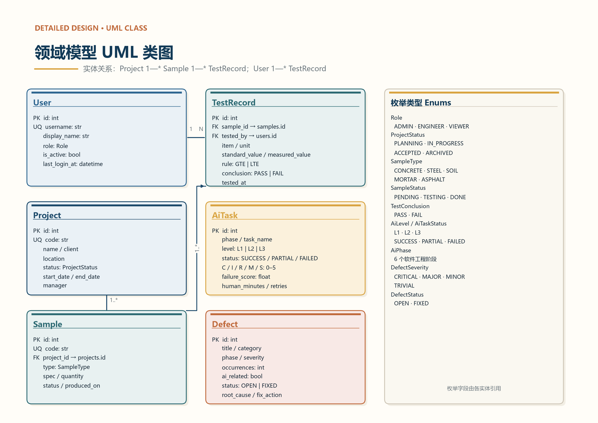
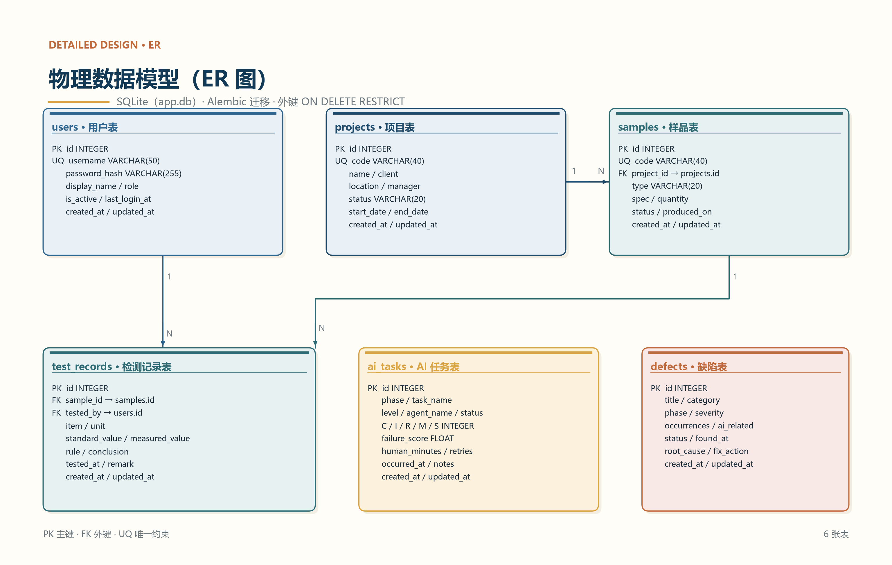

# 详细设计说明书

> 项目：筑测云 · 工程检测数据管理平台  
> 文档版本：v1.0  
> 日期：2026-11-06  
> 对应要求：作业要求第 2 条第（4）项——UML 类图与核心开发说明（类、接口、算法、异常）

## 1 设计范围

本文档描述系统的领域模型、数据库物理结构、接口契约、核心算法、异常体系与前端关键组件。总体分层与部署见《03 总体设计说明书》，实现步骤与测试见《05 实现与测试说明》。

## 2 领域模型



### 2.1 实体类

#### User（用户）

| 字段 | 类型 | 约束 | 说明 |
|---|---|---|---|
| id | int | PK，自增 | 主键 |
| username | str | 唯一、索引、3～50 位 | 登录名，仅允许字母、数字、下划线、点与短横线 |
| password_hash | str | 非空 | PBKDF2 哈希，不存明文 |
| display_name | str | 2～50 位 | 界面显示名 |
| role | str | ADMIN / ENGINEER / VIEWER | 角色 |
| is_active | bool | 默认 True | 停用后不能登录 |
| last_login_at | datetime | 可空 | 最近登录时间 |

关系：一个用户可创建多条检测记录（`TestRecord.tested_by`）。

#### Project（工程项目）

| 字段 | 类型 | 约束 | 说明 |
|---|---|---|---|
| id | int | PK | 主键 |
| code | str | 唯一、索引、3～40 位 | 项目编号，写入前统一转大写 |
| name | str | 2～120 位 | 项目名称 |
| client | str | 2～120 位 | 建设单位 |
| location | str | 2～120 位 | 项目地点 |
| status | str | PLANNING / IN_PROGRESS / ACCEPTED / ARCHIVED | 项目状态 |
| start_date / end_date | date | 可空；结束不早于开始 | 工期 |
| manager | str | 2～50 位 | 负责人 |

关系：一个项目包含多个样品（`Sample.project_id`）。

#### Sample（检测样品）

| 字段 | 类型 | 约束 | 说明 |
|---|---|---|---|
| id | int | PK | 主键 |
| code | str | 唯一、索引、3～40 位 | 样品编号，统一转大写 |
| project_id | int | FK → projects.id，RESTRICT | 所属项目 |
| type | str | CONCRETE / STEEL / SOIL / MORTAR / ASPHALT | 样品类型 |
| spec | str | 2～80 位 | 规格与说明 |
| produced_on | date | 可空 | 生产日期 |
| quantity | int | 1～1000 | 数量 |
| status | str | PENDING / TESTING / DONE | 样品状态 |

关系：一个样品包含多条检测记录（`TestRecord.sample_id`）。

#### TestRecord（检测记录）

| 字段 | 类型 | 约束 | 说明 |
|---|---|---|---|
| id | int | PK | 主键 |
| sample_id | int | FK → samples.id，索引，RESTRICT | 样品 |
| item | str | 2～60 位 | 检测项目 |
| standard_value | float | > 0，有限数 | 标准值 |
| measured_value | float | > 0，有限数 | 实测值 |
| unit | str | 1～20 位 | 计量单位 |
| rule | str | GTE / LTE | 判定规则 |
| conclusion | str | PASS / FAIL | 自动生成 |
| tested_by | int | FK → users.id，索引 | 检测人 |
| tested_at | datetime | 非空 | 检测时间 |
| remark | str | ≤255 位 | 备注 |

#### AiTask（AI 任务）

| 字段 | 类型 | 约束 | 说明 |
|---|---|---|---|
| id | int | PK | 主键 |
| phase | str | 六个阶段之一，索引 | 软件工程阶段 |
| task_name | str | 2～160 位 | 任务名称 |
| level | str | L1 / L2 / L3，索引 | 计划协作等级 |
| agent_name | str | 2～60 位 | 执行 Agent |
| status | str | SUCCESS / PARTIAL / FAILED，索引 | 任务状态 |
| correctness / completeness / runnability / maintainability / compliance | int | 0～5 | 五维失效率评分 |
| failure_score | float | 0～100 | 自动计算 |
| human_minutes | int | ≥ 0 | 人工介入分钟 |
| retries | int | ≥ 0 | 重试次数 |
| occurred_at | datetime | 非空 | 发生日期 |
| notes | text | ≤ 2000 位 | 复盘备注 |

#### Defect（缺陷）

| 字段 | 类型 | 约束 | 说明 |
|---|---|---|---|
| id | int | PK | 主键 |
| title | str | 2～160 位 | 缺陷标题 |
| phase | str | 六阶段之一，索引 | 发现阶段 |
| category | str | 2～40 位，索引 | 缺陷分类 |
| severity | str | CRITICAL / MAJOR / MINOR / TRIVIAL | 严重程度 |
| occurrences | int | 1～1000 | 累计发生次数 |
| ai_related | bool | 默认 False | 是否与 AI 产物相关 |
| status | str | OPEN / FIXED | 修复状态 |
| found_at | date | 非空 | 发现日期 |
| root_cause / fix_action | text | ≤ 2000 位 | 根因与修复措施 |

### 2.2 枚举设计

| 枚举 | 取值 |
|---|---|
| Role | ADMIN、ENGINEER、VIEWER |
| ProjectStatus | PLANNING、IN_PROGRESS、ACCEPTED、ARCHIVED |
| SampleType | CONCRETE、STEEL、SOIL、MORTAR、ASPHALT |
| SampleStatus | PENDING、TESTING、DONE |
| TestRule | GTE、LTE |
| TestConclusion | PASS、FAIL |
| AiLevel | L1、L2、L3 |
| AiTaskStatus | SUCCESS、PARTIAL、FAILED |
| AiPhase | FEASIBILITY、REQUIREMENTS、ARCHITECTURE、DETAILED_DESIGN、IMPLEMENTATION、MAINTENANCE |
| DefectSeverity | CRITICAL、MAJOR、MINOR、TRIVIAL |
| DefectStatus | OPEN、FIXED |

枚举在后端 `app/core/enums.py` 中集中定义，同时提供中文标签映射；前端 `constants/labels.js` 维护同一套标签与颜色。新增枚举时必须同时更新后端、前端和文档，否则界面会退化为显示原始代码。

## 3 物理数据库设计



数据库为 SQLite 单文件，使用 Alembic 管理版本。6 张表均包含 `created_at` 与 `updated_at`，由 ORM 默认值维护。索引覆盖唯一编号、外键、筛选字段与状态字段。

| 表 | 索引 |
|---|---|
| users | `username` 唯一索引 |
| projects | `code` 唯一索引 |
| samples | `code` 唯一索引，`project_id` 普通索引 |
| test_records | `sample_id`、`tested_by` 普通索引 |
| ai_tasks | `phase`、`level`、`status` 普通索引 |
| defects | `category`、`phase`、`severity` 普通索引 |

外键采用 `RESTRICT`，配合 Service 层删除前计数。SQLite 连接建立时执行 `PRAGMA foreign_keys=ON`，避免外键声明形同虚设。

## 4 接口设计

### 4.1 通用约定

- 前缀：`/api`。
- 认证：除登录与健康检查外，均需 `Authorization: Bearer <token>`。
- 成功：HTTP 200，`{"code": 0, "message": "ok", "data": ...}`。
- 失败：HTTP 语义状态码，`code` 为业务码，`message` 为可读中文。
- 分页：`page` 从 1 开始，`page_size` 1～100；返回 `items/total/page/page_size/pages`。
- 日期：请求使用 `YYYY-MM-DD`，时间使用 ISO 8601；响应由 FastAPI 序列化。
- 错误：不返回堆栈；详细堆栈只写服务端日志。

### 4.2 接口清单

系统共 20 个路径、34 个操作。

#### 认证与用户

| 方法 | 路径 | 权限 | 说明 |
|---|---|---|---|
| POST | `/api/auth/login` | 公开 | 登录并签发 JWT |
| POST | `/api/auth/logout` | 登录 | 返回成功，前端清理令牌 |
| GET | `/api/auth/me` | 登录 | 当前用户简要信息 |
| GET | `/api/users` | 管理员 | 用户分页与关键字搜索 |
| POST | `/api/users` | 管理员 | 新增用户，登录名唯一 |
| PATCH | `/api/users/{id}` | 管理员 | 修改显示名、角色、状态、密码；自保护 |

#### 工程项目

| 方法 | 路径 | 权限 | 说明 |
|---|---|---|---|
| GET | `/api/projects` | 登录 | 分页、关键字、状态筛选 |
| GET | `/api/projects/options` | 登录 | 未归档项目下拉选项 |
| GET | `/api/projects/{id}` | 登录 | 项目详情 |
| POST | `/api/projects` | 管理员、工程师 | 新建项目 |
| PUT | `/api/projects/{id}` | 管理员、工程师 | 更新项目 |
| DELETE | `/api/projects/{id}` | 管理员 | 存在样品时拒绝 |

#### 检测样品

| 方法 | 路径 | 权限 | 说明 |
|---|---|---|---|
| GET | `/api/samples` | 登录 | 分页、项目、类型、状态、关键字筛选 |
| GET | `/api/samples/{id}` | 登录 | 样品详情与检测记录数 |
| POST | `/api/samples` | 管理员、工程师 | 登记样品 |
| PUT | `/api/samples/{id}` | 管理员、工程师 | 更新样品 |
| DELETE | `/api/samples/{id}` | 管理员 | 存在检测记录时拒绝 |

#### 检测记录

| 方法 | 路径 | 权限 | 说明 |
|---|---|---|---|
| GET | `/api/test-records` | 登录 | 分页、项目、样品、结论、日期、关键字筛选 |
| GET | `/api/test-records/{id}` | 登录 | 记录详情 |
| POST | `/api/test-records` | 管理员、工程师 | 录入并自动判定 |
| PUT | `/api/test-records/{id}` | 管理员、工程师 | 修正并重新判定 |
| DELETE | `/api/test-records/{id}` | 管理员 | 删除记录 |

#### 看板与 AI 监管

| 方法 | 路径 | 权限 | 说明 |
|---|---|---|---|
| GET | `/api/dashboard/overview` | 登录 | KPI 与图表数据 |
| GET | `/api/ai/tasks` | 登录 | 任务分页、阶段、等级、状态、关键字筛选 |
| POST | `/api/ai/tasks` | 管理员 | 登记任务并计算 FS |
| PUT | `/api/ai/tasks/{id}` | 管理员 | 更新任务并重新评分 |
| DELETE | `/api/ai/tasks/{id}` | 管理员 | 删除任务 |
| GET | `/api/ai/defects` | 登录 | 缺陷分页与筛选 |
| POST | `/api/ai/defects` | 管理员 | 登记缺陷 |
| PUT | `/api/ai/defects/{id}` | 管理员 | 更新缺陷 |
| DELETE | `/api/ai/defects/{id}` | 管理员 | 删除缺陷 |
| GET | `/api/ai/stats` | 登录 | 可靠性、失效案例、帕累托、严重度 |
| GET | `/api/ai/grading` | 登录 | 分级机制、规则、评分表 |
| GET | `/api/health` | 公开 | 健康检查 |

## 5 核心算法

### 5.1 检测结果自动判定

输入为标准值、实测值与规则。算法先校验数值为有限正数，再保留两位小数比较，避免浮点误差导致与人工判断不一致。

```text
function judge(standard, measured, rule):
    standard = round(float(standard), 2)
    measured = round(float(measured), 2)
    if rule == "GTE":
        return "PASS" if measured >= standard else "FAIL"
    if rule == "LTE":
        return "PASS" if measured <= standard else "FAIL"
    raise BizException(40007, "不支持的判定规则")
```

边界示例：

| 规则 | 标准值 | 实测值 | 结论 |
|---|---:|---:|---|
| GTE | 30.00 | 30.00 | PASS |
| GTE | 30.00 | 29.99 | FAIL |
| LTE | 18.00 | 18.00 | PASS |
| LTE | 18.00 | 18.01 | FAIL |

判定由后端 Service 执行，前端只做预览。前端预览使用同一比较逻辑，但最终结果以后端返回为准，避免客户端篡改。

### 5.2 Agent 失效评分

五维评分取 0～5，0 表示无失效，5 表示严重失效。权重分别为正确性 25%、完整性 20%、可运行性 25%、可维护性 15%、合规与安全 15%。

```text
FS = 20 × (25C + 20I + 25R + 15M + 15S) / 100
```

等价于加权和除以 5，结果范围 0～100。失效率越高，任务越不可信。

| 任务 | C | I | R | M | S | 加权和 | FS | 等级 |
|---|---:|---:|---:|---:|---:|---:|---:|---|
| 部署脚本与端口配置 | 4 | 2 | 4 | 2 | 3 | 315 | 63.0 | 严重失效 |
| 失效评分权重与阈值设计 | 3 | 3 | 2 | 3 | 2 | 260 | 52.0 | 高失效 |
| 前后端联调（检测记录字段） | 2 | 3 | 2 | 2 | 2 | 220 | 44.0 | 高失效 |
| 权限边界与验收标准评审 | 3 | 2 | 2 | 1 | 2 | 210 | 42.0 | 高失效 |
| 可行性图表绘制 | 0 | 0 | 0 | 0 | 0 | 0 | 0.0 | 低失效 |

阈值：0～19 低失效；20～39 中失效；40～59 高失效；60～100 严重失效。FS ≥ 40 时协作等级上调一级，FS ≥ 60 直接转 L3 并做根因分析。详细评分锚点与监管流程见《08 评级监管设计说明》。

### 5.3 阶段综合可靠性

阶段综合可靠性同时考虑失效分与一次通过率，避免“分数低但大量返工”被掩盖。

```text
R = 0.6 × (100 − 平均 FS) + 0.4 × 一次通过率 × 100
一次通过率 = SUCCESS 任务数 / 任务总数
```

以实现与测试阶段为例：平均 FS 为 28.8，一次通过率为 50%，则：

```text
R = 0.6 × (100 − 28.8) + 0.4 × 50 = 62.72 ≈ 62.8
```

全项目平均 FS 为 13.4，一次通过率 83.3%，综合可靠性为：

```text
R = 0.6 × 86.6 + 0.4 × 83.3 = 85.28 ≈ 85.3
```

### 5.4 缺陷帕累托

```text
1. 按 category 汇总 occurrences
2. 按发生次数降序排序
3. total = 所有发生次数之和
4. 依次累加，计算 share = occ / total、cumulative = 累计 / total
5. 找到累计占比首次 >= 80% 的分类，作为主要改进分界
```

当前数据共 68 次缺陷，前四类累计 76.5%，第五类“边界条件缺失”使累计达到 86.8%，跨越 80% 参考线。该结果直接用于维护报告的改进优先级。

## 6 异常设计

### 6.1 业务异常

`BizException` 包含业务码、消息与 HTTP 状态码。全局异常处理器将其转换为统一响应包，不返回堆栈。

| 业务码 | HTTP | 含义 | 典型场景 |
|---|---:|---|---|
| 0 | 200 | 成功 | 正常业务 |
| 40001 | 400 | 业务校验失败 | 结束日期早于开始日期 |
| 40002 | 400 | 关联资源不存在 | 项目或样品不存在 |
| 40003 | 400 | 当前账号保护 | 停用或降级自己 |
| 40005 | 400 | 项目存在样品 | 删除项目被拒绝 |
| 40006 | 400 | 样品存在检测记录 | 删除样品被拒绝 |
| 40007 | 400 | 判定规则不支持 | 非法 GTE/LTE |
| 40101 | 401 | 未登录或凭证无效 | 缺少令牌、过期、密码错误 |
| 40102 | 403 | 账号停用 | 停用账号登录 |
| 40301 | 403 | 无权限 | 查阅人员写操作 |
| 40401 | 404 | 资源不存在 | 项目、样品、记录、用户、任务、缺陷 |
| 40901 | 409 | 唯一约束冲突 | 项目编号、样品编号、登录名重复 |
| 42201 | 422 | 参数校验失败 | 字段缺失、类型错误、范围错误 |
| 40501 | 405 | 请求方法不支持 | 对只读接口使用 DELETE |
| 50000 | 500 | 未预期异常 | 数据库或代码异常，仅日志保留堆栈 |

### 6.2 参数校验异常

Pydantic 校验失败由 `RequestValidationError` 捕获，提取字段位置与错误信息，拼接为“参数校验失败（字段: 说明）”。HTTP 状态为 422，业务码 42201。前端展示消息，不展示堆栈。

### 6.3 未预期异常

全局兜底处理器记录请求方法、路径与堆栈到服务端日志，返回“服务器内部错误，请稍后重试”。演示环境不开启调试模式，避免泄露内部细节。

### 6.4 前端异常处理

Axios 响应拦截器统一处理：

1. `code === 0` 时返回 `data`，业务代码不重复解包。
2. 业务码非 0 时弹出后端消息并拒绝 Promise。
3. HTTP 401 时清理本地令牌，提示后跳转登录。
4. 网络错误与超时给出统一提示。

## 7 前端详细设计

### 7.1 路由与守卫

路由使用 hash 模式，避免演示环境的服务器回退配置。守卫逻辑：公开页允许访问；未登录跳转登录页并携带 redirect；管理员页面校验角色；已登录用户访问登录页时跳转看板。

### 7.2 状态管理

认证状态保存在响应式对象与 `localStorage` 中，包含令牌与用户简要信息。登录成功后写入，退出时清理。角色判断由 `isAdmin()` 与 `canEdit()` 完成，页面按权限显示按钮。

### 7.3 组件设计

| 组件 | 职责 |
|---|---|
| `AppLayout` | 侧边栏、顶栏、用户菜单、AI 可靠性概览 |
| `ChartPanel` | ECharts 初始化、配置更新、ResizeObserver、销毁与空状态 |
| `StatCard` | KPI 卡片与色调 |
| `StatusPill` | 统一状态标签与颜色映射 |
| `http.js` | 注入 JWT、解包响应、错误提示、401 跳转 |
| 各业务视图 | 筛选、分页、表单校验、弹窗、操作确认 |

### 7.4 表单与交互

项目、样品、检测记录、AI 任务、缺陷均使用 Element Plus 表单与校验规则。检测记录弹窗提供实时判定预览；AI 任务弹窗使用五个滑块并实时显示 FS 和失效等级；删除操作使用确认框；所有弹窗挂载到 body，避免页面动画导致定位异常。

## 8 设计约束与已知取舍

1. SQLite 适合单用户演示，不支持高并发写入。
2. JWT 无刷新令牌，令牌过期后需要重新登录。
3. AI 评分包含人工判断，存在主观性；通过评分锚点、双人复核和阈值校准降低偏差。
4. 演示账号密码公开，仅用于本地环境。
5. 前端令牌存储在 localStorage，生产环境应改为 HttpOnly Cookie。
6. 检测记录暂未实现重复提交拦截，已登记为待修复缺陷。

## 9 与代码的对应关系

| 设计内容 | 代码位置 |
|---|---|
| 枚举与标签 | `backend/app/core/enums.py`、`frontend/src/constants/labels.js` |
| 判定算法 | `backend/app/modules/test_records/service.py` |
| 失效评分与可靠性 | `backend/app/modules/ai_ops/service.py` |
| 分级机制 | `backend/app/modules/ai_ops/grading.py` |
| 异常与响应 | `backend/app/core/exceptions.py`、`core/response.py` |
| 鉴权与 RBAC | `backend/app/core/security.py`、`core/deps.py` |
| 前端拦截器 | `frontend/src/api/http.js` |
| ECharts 封装 | `frontend/src/components/ChartPanel.vue` |

文档中的公式、阈值与统计数字均来自系统实际数据与接口快照，修改算法时应同步更新本文档、前端说明与维护报告。
