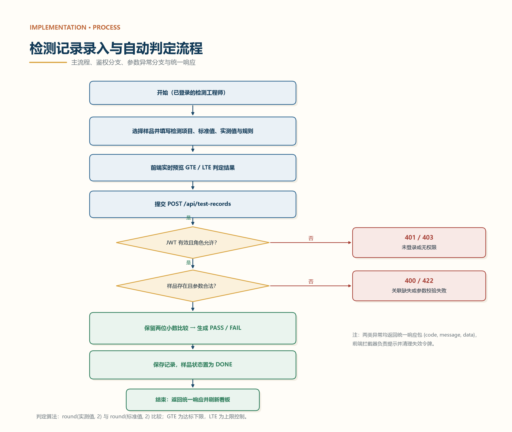
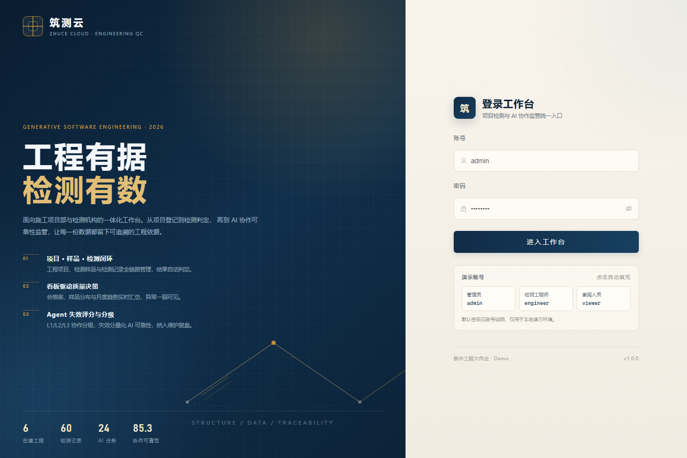
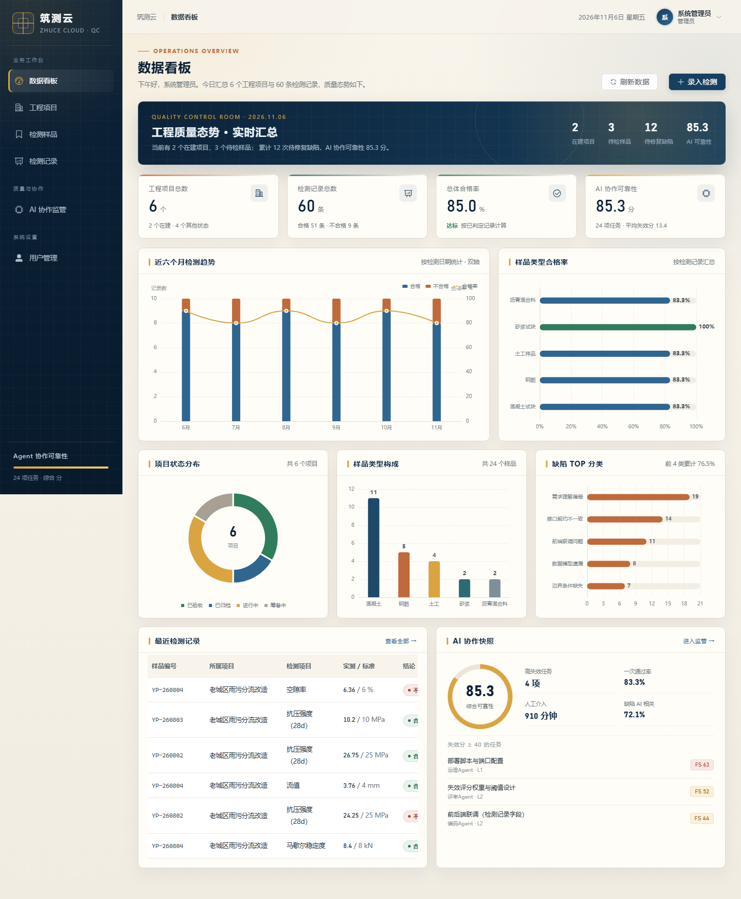
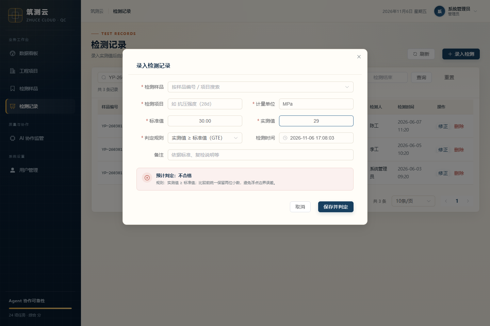
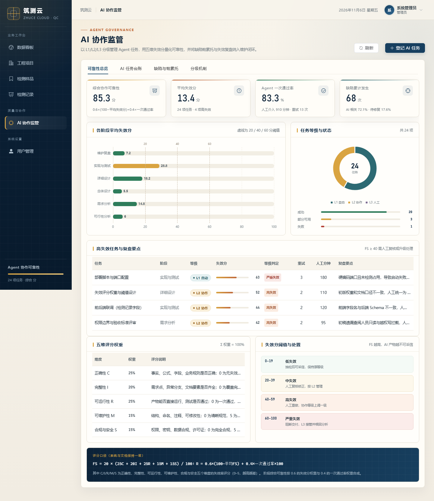
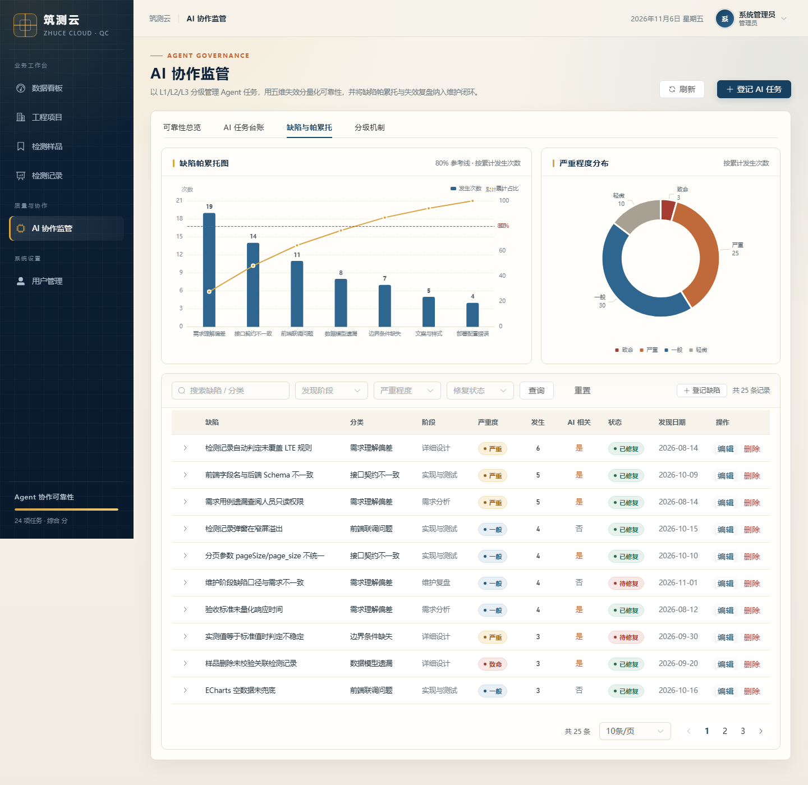

# 实现与测试说明

> 项目：筑测云 · 工程检测数据管理平台  
> 文档版本：v1.0  
> 日期：2026-11-06  
> 对应要求：作业要求第 2 条第（5）项——程序流程图与测试设计说明（模块、功能测试）

## 1 实现环境

| 项目 | 版本 / 配置 |
|---|---|
| 操作系统 | Windows（本地工作区） |
| Python | 3.12.3 |
| 虚拟环境 | `.venv`，位于项目根目录，不写入系统目录 |
| FastAPI | 0.162.0 |
| SQLAlchemy | 2.1.8 |
| Alembic | 1.20.1 |
| Pydantic | 2.14.3 |
| Uvicorn | 0.54.0 |
| PyJWT | 2.15.1 |
| pytest | 9.2.0 |
| python-docx | 1.2.0 |
| Matplotlib | 3.11.2 |
| Node.js | v24.11.0 |
| npm | 11.12.0 |
| Vue | 3.5.45 |
| Vue Router | 4.6.4 |
| Element Plus | 2.14.7 |
| ECharts | 5.6.0 |
| Vite | 6.4.5 |
| 浏览器 | Microsoft Edge（headless 端到端验证） |

## 2 实现范围与启动方式

实现范围覆盖登录鉴权、用户管理、项目、样品、检测记录、自动判定、看板、AI 任务、缺陷与可靠性统计。前端构建产物写入 `backend/app/static`，由 FastAPI 同源托管。

启动方式：

```bat
scripts\start.bat
```

脚本会依次执行 Alembic 迁移、检查演示数据、启动 uvicorn，并写入真实监听 PID。停止方式：

```bat
scripts\stop.bat
```

开发模式：

```bash
cd backend
..\.venv\Scripts\python.exe -m uvicorn app.main:app --reload --port 8000

cd frontend
npm run dev
```

访问地址：`http://127.0.0.1:8000`，API 文档：`http://127.0.0.1:8000/api/docs`。演示账号：

| 角色 | 账号 | 密码 |
|---|---|---|
| 管理员 | admin | admin123 |
| 检测工程师 | engineer | engineer123 |
| 查阅人员 | viewer | viewer123 |

## 3 核心程序流程



流程说明：

1. 已登录工程师选择样品，填写检测项目、标准值、实测值、单位与规则。
2. 前端实时预览判定，帮助发现录入错误。
3. 提交后依次经过 JWT/RBAC 校验与参数、关联校验。
4. 校验通过后保留两位小数比较，生成 PASS/FAIL。
5. 保存记录，样品状态置为 DONE，返回统一响应并刷新看板。
6. 鉴权失败返回 401/403，参数或关联失败返回 400/422，均走统一响应包。

## 4 界面实现



登录页采用工程蓝图风格，提供演示账号一键填充。左侧展示系统定位、三项核心能力与演示数据指标，右侧为登录表单。



看板展示 4 个 KPI、近六个月检测趋势、样品类型合格率、项目状态、样品构成、缺陷 TOP 分类、最近记录与 AI 协作快照。数据全部来自 `/api/dashboard/overview` 与 `/api/ai/stats`。



检测记录弹窗支持样品检索、标准值与实测值输入、GTE/LTE 规则选择，并实时显示“预计判定”。示例中实测值 29 小于标准值 30，预览为不合格。



AI 监管页展示综合可靠性、平均失效分、一次通过率、缺陷累计、各阶段失效分、等级分布、高失效案例、评分权重与阈值。



缺陷页展示帕累托图、严重度分布、缺陷台账与展开后的根因和修复措施。图中数据与维护报告一致。

## 5 测试策略

采用三层验证：

1. **单元与接口测试**：pytest + httpx，使用独立内存 SQLite，每个测试重新建表并注入固定数据。
2. **端到端测试**：Edge + playwright-core，真实浏览器登录并走通核心页面，截图留证。
3. **静态与运行检查**：Python 导入检查、Alembic 迁移、种子重建、前端构建、API 健康检查。

测试数据采用固定夹具，覆盖正常值、边界值、越权、重复、关联缺失与非法参数。负向用例同时断言 HTTP 状态码、业务码和提示消息，避免只看状态码造成假通过。

## 6 后端测试结果

执行命令：

```bash
cd backend
..\.venv\Scripts\python.exe -m pytest --cov=app --cov-report=term-missing
```

结果：**56 个测试全部通过**，语句覆盖率 **88%**（1251 条语句，147 条未覆盖），耗时约 11 秒。完整输出与覆盖率明细见 `evidence/pytest_full.txt`。

| 测试文件 | 用例数 | 覆盖内容 |
|---|---:|---|
| `test_auth.py` | 9 | 登录成功/失败、停用账号、参数校验、当前用户、退出 |
| `test_permissions.py` | 7 | 三角色越权、用户列表与创建、重复登录名、管理员自保护 |
| `test_projects.py` | 11 | 列表、选项、创建、编号归一、重复、日期校验、更新、删除保护、筛选 |
| `test_samples_records.py` | 13 | 样品筛选与校验、删除保护、GTE/LTE 边界、修正重判、结论筛选、越权 |
| `test_dashboard_ai.py` | 13 | 看板统计、可靠性公式、分级配置、任务评分与重评、缺陷帕累托、权限 |
| `test_http_errors.py` | 3 | 健康检查、404、405 统一异常 |
| **合计** | **56** | 认证、权限、业务、算法、统计、异常 |

### 6.1 代表性测试用例

| 编号 | 模块 | 场景与输入 | 预期 | 实际 |
|---|---|---|---|---|
| TC-AUTH-01 | 认证 | admin / pass123 登录 | 200，code=0，返回令牌 | 通过 |
| TC-AUTH-02 | 认证 | 错误密码 | 401，code=40101，消息“用户名或密码错误” | 通过 |
| TC-AUTH-03 | 认证 | 停用账号登录 | 403，code=40102 | 通过 |
| TC-AUTH-04 | 认证 | 不携带令牌访问 `/auth/me` | 401，code=40101 | 通过 |
| TC-AUTH-05 | 认证 | 短密码与缺失字段 | 422，code=42201 | 通过 |
| TC-PERM-01 | 权限 | 查阅人员新建项目 | 403，code=40301 | 通过 |
| TC-PERM-02 | 权限 | 工程师访问用户列表 | 403，code=40301 | 通过 |
| TC-PERM-03 | 权限 | 管理员创建重复登录名 | 409，code=40901 | 通过 |
| TC-PERM-04 | 权限 | 管理员停用自己 | 400，code=40003 | 通过 |
| TC-PROJ-01 | 项目 | 列表应返回 3 个项目，项目一有 2 个样品 | 统计一致 | 通过 |
| TC-PROJ-02 | 项目 | 编号 `xm-t-100` 新建 | 归一为 `XM-T-100`，默认筹备中 | 通过 |
| TC-PROJ-03 | 项目 | 重复编号新建 | 409，code=40901 | 通过 |
| TC-PROJ-04 | 项目 | 结束日期早于开始日期 | 422，消息包含日期错误 | 通过 |
| TC-PROJ-05 | 项目 | 删除有样品的项目 | 400，code=40005 | 通过 |
| TC-PROJ-06 | 项目 | 删除空项目后查询 | 删除成功，再查返回 404 | 通过 |
| TC-SAMP-01 | 样品 | 按类型 CONCRETE 筛选 | 返回 2 个样品 | 通过 |
| TC-SAMP-02 | 样品 | 关联不存在的项目 | 400，code=40002 | 通过 |
| TC-SAMP-03 | 样品 | 删除有检测记录的样品 | 400，code=40006 | 通过 |
| TC-TEST-01 | 判定 | GTE，30.00 / 30.00 | PASS | 通过 |
| TC-TEST-02 | 判定 | GTE，30.00 / 29.99 | FAIL | 通过 |
| TC-TEST-03 | 判定 | LTE，18.00 / 18.00 与 18.01 | 前者 PASS，后者 FAIL | 通过 |
| TC-TEST-04 | 判定 | 修正实测值 29 → 31 | 结论由 FAIL 变 PASS | 通过 |
| TC-TEST-05 | 判定 | 不存在的样品 | 400，code=40002 | 通过 |
| TC-DASH-01 | 看板 | 固定夹具汇总 | 3 项目、4 样品、8 记录、合格率 75.0% | 通过 |
| TC-DASH-02 | 看板 | 图表数据 | 类型合格率、六个月趋势、最近记录正确 | 通过 |
| TC-AI-01 | AI | 五维评分 (3,2,2,1,2) | FS=42.0 | 通过 |
| TC-AI-02 | AI | 固定夹具统计 | 平均 FS 20.5，可靠性 74.4，高失效 2 | 通过 |
| TC-AI-03 | AI | 新建五维全 2 分任务 | FS=40.0，等级高失效 | 通过 |
| TC-AI-04 | AI | 将任务改为全 0 分 | FS=0，等级低失效 | 通过 |
| TC-AI-05 | AI | 新增 3 次部署缺陷 | 缺陷累计 21 次，帕累托新增分类 | 通过 |
| TC-AI-06 | AI | 分级配置 | 3 个等级、6 个阶段、5 条规则、权重和 100% | 通过 |
| TC-ERR-01 | 异常 | 访问不存在 API | 404，code=40401 | 通过 |
| TC-ERR-02 | 异常 | 对健康检查使用 DELETE | 405，code=40501 | 通过 |

其余用例为参数化组合、重复校验与辅助断言，均包含在 56 个测试中。测试使用独立数据库，不污染演示数据。

### 6.2 覆盖率说明

覆盖率较高的部分包括枚举、Schema、模型、认证服务、项目服务、看板服务与大部分路由。未覆盖部分主要是少数删除分支、异常兜底、静态资源路由和部分 AI 删除接口。覆盖率不是质量本身，因此同时保留端到端验证与边界用例。

## 7 端到端测试

执行命令：

```bash
cd frontend
node e2e/ui-check.mjs
```

验证结果：**通过**。使用本机 Edge headless，浏览器控制台无错误，`/api` 无 4xx/5xx；生成 12 张截图，保存于 `evidence/ui/`，结果汇总见 `evidence/ui/e2e_summary.txt` 与 `e2e_result.json`。

| 编号 | 场景 | 关键断言 | 结果 |
|---|---|---|---|
| E2E-01 | 登录页与登录 | 标题、演示账号、进入看板 | 通过 |
| E2E-02 | 看板 | 项目 6、记录 60、可靠性 85.3、图表渲染 | 通过 |
| E2E-03 | 项目 CRUD | 新建临时项目、表格可见、删除后消失 | 通过 |
| E2E-04 | 样品 | 总数 24，筛选后 1，登记弹窗字段完整 | 通过 |
| E2E-05 | 检测记录 | 总数 60，31≥30 合格、29<30 不合格预览 | 通过 |
| E2E-06 | AI 总览 | 可靠性 85.3、平均失效分、图表 | 通过 |
| E2E-07 | AI 任务台账 | 任务列表、等级、评分列可见 | 通过 |
| E2E-08 | 缺陷与帕累托 | 帕累托图与台账可见 | 通过 |
| E2E-09 | 分级机制 | 三张等级卡、六阶段矩阵、规则 | 通过 |
| E2E-10 | 用户管理 | 4 个账号、角色与状态可见 | 通过 |

截图清单：登录、看板、项目、样品弹窗、样品列表、检测弹窗、检测列表、AI 总览、AI 任务、缺陷、分级机制、用户管理。E2E 会创建并删除一个临时项目，结束后数据恢复为 6 个项目。

## 8 构建与质量证据

| 检查项 | 命令 | 结果 |
|---|---|---|
| 后端导入 | `python -c "from app.main import app"` | 通过 |
| 数据库迁移 | `alembic upgrade head` | 通过，生成初始版本 |
| 种子数据 | `seed.py --reset` | 4 用户 / 6 项目 / 24 样品 / 60 记录 / 24 任务 / 25 缺陷 |
| 后端测试 | `pytest --cov=app` | 56 passed，88% |
| 前端构建 | `npm run build` | 通过，产物写入 backend/app/static |
| 端到端 | `node e2e/ui-check.mjs` | 通过，12 张截图，无控制台/API 错误 |
| 健康检查 | `GET /api/health` | 200，status=up |

## 9 缺陷与限制

实现阶段登记的已知问题包括：检测记录重复提交拦截未完成、错误码与前端提示映射仍有缺口、AI 评分锚点需要继续细化、SQLite 不适合高并发写入、JWT 无刷新令牌。以上问题均已在缺陷台账中记录，其中三项处于待修复状态，维护计划见《06 维护与 Agent 失效复盘》。

## 10 需求追踪

| 需求 | 实现证据 | 测试证据 |
|---|---|---|
| 登录与权限 | `auth`、`users`、路由守卫 | TC-AUTH、TC-PERM |
| 项目与样品 | `projects`、`samples` 模块与页面 | TC-PROJ、TC-SAMP |
| 检测与判定 | `test_records` 模块与流程 | TC-TEST、E2E-05 |
| 看板 | `dashboard` 模块与 ECharts | TC-DASH、E2E-02 |
| AI 监管 | `ai_ops` 模块、四标签页 | TC-AI、E2E-06 至 E2E-09 |
| 异常与响应 | 全局异常、Axios 拦截器 | TC-ERR、TC-AUTH-04 |
| 非功能与交付 | 测试、E2E、图表、Word 报告 | 第 8 节质量证据 |
