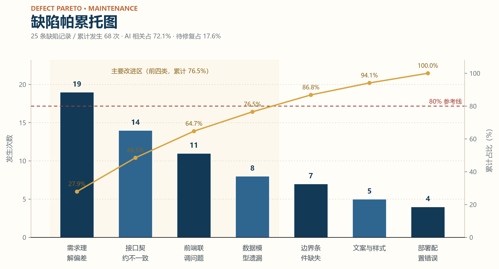
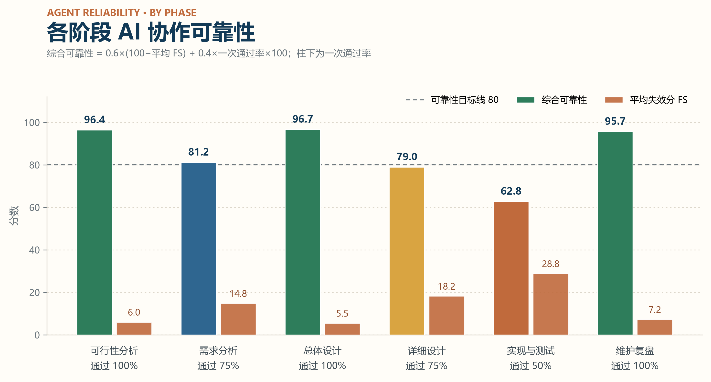

# 维护与 Agent 失效复盘

> 项目：筑测云 · 工程检测数据管理平台  
> 文档版本：v1.0  
> 日期：2026-11-06  
> 对应要求：作业要求第 2 条第（6）项——缺陷帕累托图、Agent 失效复盘与修改说明，并将失效评分纳入 AI 可靠性评价

## 1 维护目标与数据来源

维护阶段的目标是回答三个问题：哪些缺陷最值得先修；AI 在哪些阶段最不可靠；修复是否真正进入系统并被测试锁定。本文档的缺陷与 AI 任务数据来自系统数据库，统计接口为 `/api/ai/stats` 与 `/api/dashboard/overview`，图表由同一份快照生成，保证文档、页面与图表口径一致。

数据规模：25 条缺陷记录，累计发生 68 次；24 条 AI 任务；60 条检测记录。统计截至 2026-11-06。

## 2 缺陷帕累托分析



| 排名 | 缺陷分类 | 发生次数 | 占比 | 累计占比 | 主要来源 |
|---:|---|---:|---:|---:|---|
| 1 | 需求理解偏差 | 19 | 27.9% | 27.9% | 规则口径、权限边界、验收标准 |
| 2 | 接口契约不一致 | 14 | 20.6% | 48.5% | 字段命名、分页参数、错误码、日期格式 |
| 3 | 前端联调问题 | 11 | 16.2% | 64.7% | 响应式、空数据、筛选分页、登录过期 |
| 4 | 数据模型遗漏 | 8 | 11.8% | 76.5% | 删除校验、用户快照、编号归一、日期类型 |
| 5 | 边界条件缺失 | 7 | 10.3% | 86.8% | 判定边界、零分母、重复提交 |
| 6 | 文案与样式 | 5 | 7.4% | 94.1% | 角色名称、移动端布局、空状态 |
| 7 | 部署配置错误 | 4 | 5.9% | 100.0% | 端口占用、数据库路径、构建产物 |

### 2.1 结论

前四类缺陷累计占 **76.5%**，是主要改进区。第五类“边界条件缺失”使累计占比达到 **86.8%**，跨越 80% 参考线。按照帕累托原则，应优先处理前四类，同时把边界条件纳入回归测试，而不是平均分配维护资源。

### 2.2 分类分析

**需求理解偏差（19 次）**是最大来源，集中在检测规则与权限边界。根因是 AI 初稿把业务规则写成描述性文字，没有转成可测试的条件。例如“达到标准”被简单理解为大于等于，遗漏了含水率、流值等上限指标。改进措施包括：把判定规则写成 GTE/LTE 表；用例验收标准必须包含边界值；关键口径由人确认后再进入开发。

**接口契约不一致（14 次）**主要发生在前后端并行生成时。前端使用 camelCase，后端使用 snake_case；分页参数与错误码也没有统一字典。改进措施包括：统一 snake_case 与统一响应包；OpenAPI 作为契约；联调用例覆盖字段、分页、日期与错误提示。

**前端联调问题（11 次）**多为体验与边界问题，例如窄屏弹窗溢出、空数据没有占位、筛选重置未清空分页、401 未统一跳转。改进措施包括：`ChartPanel` 空状态、弹窗宽度自适应、筛选变更重置页码、Axios 拦截器统一处理 401。

**数据模型遗漏（8 次）**包括删除父记录未校验子记录、用户停用后历史记录显示异常、项目编号大小写未归一、AI 任务日期类型不一致。改进措施包括：外键 + Service 双重校验、编号统一大写、Schema 与 ORM 类型统一、历史记录按用户 ID 关联。

**边界条件缺失（7 次）**中，判定边界已通过保留两位小数和自动化测试修复；重复提交拦截仍待完成；错误码映射与维护口径仍在待修复状态。

## 3 严重度与修复状态

| 严重程度 | 发生次数 | 说明 |
|---|---:|---|
| 致命 | 3 | 删除保护缺失等可能造成数据不一致的问题 |
| 严重 | 25 | 影响业务正确性或主要流程 |
| 一般 | 30 | 影响体验或局部功能 |
| 轻微 | 10 | 文案、样式与低风险问题 |

| 指标 | 数值 | 说明 |
|---|---:|---|
| 缺陷累计发生 | 68 次 | 25 条记录的发生次数之和 |
| 待修复发生次数 | 12 次 | 占 17.6% |
| 已修复发生次数 | 56 次 | 占 82.4% |
| AI 相关发生次数 | 49 次 | 占 72.1% |
| 非 AI 相关发生次数 | 19 次 | 占 27.9% |

AI 相关占比高并不等于“AI 不可用”，而是说明 AI 产物必须经过人审与自动化门禁。非 AI 相关缺陷主要来自人工口径维护与少量样式问题。

## 4 Agent 失效评分纳入维护评价

按照作业要求，Agent 失效评分不仅用于单任务处置，还纳入维护阶段评价 AI 的可靠程度。评分方法如下。

```text
FS = 20 × (25C + 20I + 25R + 15M + 15S) / 100
```

其中 C、I、R、M、S 分别为正确性、完整性、可运行性、可维护性、合规与安全，取值 0～5，越高表示失效越严重。阶段综合可靠性同时考虑失效分与一次通过率：

```text
R = 0.6 × (100 − 平均 FS) + 0.4 × 一次通过率 × 100
```



| 阶段 | 任务数 | 平均失效分 | 一次通过率 | 综合可靠性 | 高失效任务 |
|---|---:|---:|---:|---:|---:|
| 可行性分析 | 4 | 6.0 | 100.0% | 96.4 | 0 |
| 需求分析 | 4 | 14.8 | 75.0% | 81.2 | 1 |
| 总体设计 | 4 | 5.5 | 100.0% | 96.7 | 0 |
| 详细设计 | 4 | 18.2 | 75.0% | 79.0 | 1 |
| 实现与测试 | 4 | 28.8 | 50.0% | 62.8 | 2 |
| 维护复盘 | 4 | 7.2 | 100.0% | 95.7 | 0 |
| **全项目** | **24** | **13.4** | **83.3%** | **85.3** | **4** |

全项目综合可靠性 **85.3 分**，高于 80 分目标线；但实现与测试阶段只有 **62.8 分**，明显低于其他阶段，是维护重点。该阶段 4 项任务中 2 项高失效、一次通过率 50%，说明编码与联调环节需要更严格的契约校验与联调回归。

AI 任务共发生 4 项高失效（FS ≥ 40），累计人工介入 **910 分钟**，重试 **13 次**。这些数据说明 AI 提高了产出速度，但没有消除复核成本；失效评分把“返工成本”显性化，便于在后续排期中预留人审时间。

## 5 典型 Agent 失效复盘

### 5.1 案例一：部署脚本与端口配置（FS=63.0）

| 维度 | 得分 | 判断依据 |
|---|---:|---|
| 正确性 C | 4 | 端口硬编码，未检测占用，启动直接失败 |
| 完整性 I | 2 | 缺少端口检测与失败提示，日志位置不完整 |
| 可运行性 R | 4 | 首次启动失败，需要人工排查 |
| 可维护性 M | 2 | 脚本结构可读，但 PID 处理不可靠 |
| 合规与安全 S | 3 | 未造成数据泄露，但存在误杀进程风险 |
| **FS** | **63.0** | **严重失效，按规则直接转 L3** |

**现象**：启动脚本运行后服务未就绪，端口被旧进程占用；脚本用 shell 的 `$!` 作为 PID，停止时可能误杀其他进程。

**根因**：AI 生成脚本时只考虑了“能启动”，没有把端口占用、进程归属和失败恢复作为验收条件；对 Windows 与 Git Bash 的 PID 差异缺少验证。

**修复**：端口可通过 `ZHCE_PORT` 覆盖；启动前检测端口占用并给出可操作提示；使用 `Get-NetTCPConnection` 读取真实监听 PID 并写入 `.run/server.pid`；停止前比对 PID 与端口监听进程，不一致时拒绝停止；改用 `pythonw.exe` 分离服务进程，日志写入文件。

**验证**：重复执行启动脚本时提示“服务已在运行”；端口被占用时不启动新服务；停止脚本只停止对应 PID；服务重启后健康检查与页面访问正常。

**预防**：部署类任务从 L1 上调为 L2 管理；验收必须包含“首次启动、重复启动、端口冲突、停止服务”四个场景；脚本改动必须实际执行，不以静态阅读代替验证。

### 5.2 案例二：失效评分权重与阈值设计（FS=52.0）

| 维度 | 得分 | 判断依据 |
|---|---:|---|
| 正确性 C | 3 | 初版权重与文档口径不一致，维度方向解释矛盾 |
| 完整性 I | 3 | 有公式与阈值，但缺少评分锚点与复核流程 |
| 可运行性 R | 2 | 公式可算，但与系统实现未对齐 |
| 可维护性 M | 3 | 结构可读，口径分散在多个文件 |
| 合规与安全 S | 2 | 无直接安全问题，但评价可能误导决策 |
| **FS** | **52.0** | **高失效，人工重做** |

**现象**：初版文档中“分数越高越好”与“失效分越高越差”混用；权重在页面与文档中不一致，导致同一任务出现不同 FS。

**根因**：AI 在生成评分说明时没有区分“质量分”和“失效分”，也没有把权重作为单一配置源。

**修复**：统一为五维失效分，明确 0 表示无失效、5 表示严重失效；权重固定为 25/20/25/15/15；公式、阈值、评分锚点分别落在 `ai_ops/service.py`、`ai_ops/grading.py` 与文档中，并通过单元测试锁定；前端实时预览与后端计算使用同一公式。

**验证**：`compute_failure_score(5,5,5,5,5)=100`、`(0,0,0,0,0)=0`、`(3,2,2,1,2)=42` 均通过；页面评分与统计接口一致。

**预防**：评分口径变更必须同时修改代码、前端说明、维护文档与测试；高失效阈值附近的任务由第二人复核。

### 5.3 案例三：前后端联调字段不一致（FS=44.0）

| 维度 | 得分 | 判断依据 |
|---|---:|---|
| 正确性 C | 2 | 前端字段名与后端 Schema 不一致，提交失败 |
| 完整性 I | 3 | 主要字段齐全，缺少统一契约与错误映射 |
| 可运行性 R | 2 | 联调阶段阻塞 |
| 可维护性 M | 2 | 命名风格混用，后续易复发 |
| 合规与安全 S | 2 | 无安全影响，但可能导致数据错位 |
| **FS** | **44.0** | **高失效，人工重做** |

**现象**：前端使用 camelCase，后端使用 snake_case；分页参数 `pageSize` 与 `page_size` 不一致，联调时出现 422 或空列表。

**根因**：前后端由不同提示词生成，缺少共享契约；测试只覆盖后端单方输入，没有覆盖真实浏览器请求。

**修复**：后端统一 snake_case；Axios 请求集中封装；统一分页参数；以 OpenAPI 与联调用例作为契约；增加 Edge E2E，覆盖登录、录入预览、项目增删与 AI 页面。

**验证**：E2E 的 API 响应无 4xx/5xx；检测记录预览、项目创建与删除、样品筛选均通过；后端 56 个测试全通过。

**预防**：接口字段变更先改契约再改代码；联调任务默认 L2；每次发布前执行 E2E。

### 5.4 案例四：权限边界与验收标准评审（FS=42.0）

| 维度 | 得分 | 判断依据 |
|---|---:|---|
| 正确性 C | 3 | 初稿遗漏查阅人员不可写，越权边界不完整 |
| 完整性 I | 2 | 验收标准缺少负向用例 |
| 可运行性 R | 2 | 代码侧已有角色，但未覆盖只读场景 |
| 可维护性 M | 1 | 权限说明分散，未形成矩阵 |
| 合规与安全 S | 2 | 存在越权写入风险 |
| **FS** | **42.0** | **高失效，人工重做** |

**现象**：需求初稿只描述管理员与工程师的权限，没有明确查阅人员只读；前端隐藏了按钮，但后端仍可能接受写请求。

**根因**：AI 把“权限”理解为页面显示，没有把“服务端强制校验”和“负向测试”纳入验收。

**修复**：补充角色权限矩阵；后端写操作统一使用 `require_roles`；前端路由守卫与按钮隐藏作为体验层；新增 403 越权测试；在用例图和需求文档中明确查阅人员只读。

**验证**：查阅人员新建项目、工程师访问用户列表均返回 403，业务码 40301；管理员正常操作；E2E 按角色登录验证。

**预防**：所有权限需求必须同时给出“允许”和“拒绝”用例；关键接口默认拒绝，按角色显式放行。

## 6 修复与回归记录

| 修复项 | 关联缺陷 | 代码位置 | 回归证据 | 状态 |
|---|---|---|---|---|
| GTE/LTE 双规则 | 自动判定未覆盖 LTE | `test_records/service.py` | 边界测试 4 项 | 已修复 |
| 保留两位小数比较 | 判定边界不稳定 | `test_records/service.py` | 30/30、18/18 用例 | 技术已修复，流程待关闭 |
| 删除父记录前校验子记录 | 样品/项目删除保护 | `projects/service.py`、`samples/service.py` | 40005/40006 用例 | 已修复 |
| 项目编号统一大写 | 编号大小写不一致 | `projects/schemas.py` | 编号归一用例 | 已修复 |
| 统一响应包与异常 | 错误提示不统一 | `core/response.py`、`core/exceptions.py` | 404/405/422 用例 | 已修复 |
| 登录过期统一跳转 | 401 未清理令牌 | `frontend/src/api/http.js` | E2E 登录流程 | 已修复 |
| 筛选重置分页 | 列表页码残留 | 各列表视图 | E2E 样品/记录筛选 | 已修复 |
| 端口与 PID 处理 | 启动脚本失败 | `scripts/start_server.ps1`、`stop_server.ps1` | 启动、重复启动、停止 | 已修复 |
| 弹窗宽度自适应 | 窄屏溢出 | `styles/global.css` | 1440 与窄屏样式检查 | 已修复 |
| 空数据占位 | 图表/表格空态 | `ChartPanel.vue` | 空数据渲染检查 | 已修复 |

## 7 维护计划

### 7.1 例行维护

| 周期 | 内容 | 输出 |
|---|---|---|
| 每次发布前 | 跑 56 个后端测试、Edge E2E、迁移与种子重建 | 测试输出与截图 |
| 每周 | 查看待修复缺陷、高失效任务、可靠性变化 | 维护周报 |
| 每两周 | 复核 FS ≥ 40 的任务与评分锚点 | 复核记录 |
| 每月 | 备份 `app.db`，检查依赖安全更新 | 备份与升级记录 |
| 每季度 | 重新校准评分阈值与权重 | 新版本评分说明 |

### 7.2 发布门禁

1. 后端测试全部通过，覆盖率不低于 80%。
2. E2E 无控制台错误与 API 4xx/5xx（预期负向用例除外）。
3. 全项目综合可靠性不低于 80 分。
4. 任一阶段低于 70 分时，必须提交该阶段任务的人工复核记录与改进措施。当前实现与测试阶段为 62.8 分，已触发该条件，改进措施为契约先行、联调 L2、E2E 回归。
5. FS ≥ 60 的任务必须有根因分析与修复验证，未关闭前不得发布相关功能。
6. 数据库迁移脚本必须可在空库与已有库上执行。

### 7.3 触发式维护

- 同一类缺陷在两周内重复出现 2 次，升级为专项改进。
- 连续 2 个同类 AI 任务失败，人工接管并调整提示词或流程。
- 出现数据丢失、越权或密钥泄露迹象，立即停止演示环境并排查。
- 依赖出现高危漏洞，评估升级或隔离。

### 7.4 数据与配置维护

演示数据可通过 `seed.py --reset` 重建；重建前应备份 `backend/data/app.db`。生产化时应使用 PostgreSQL、定时备份与迁移回滚演练。配置项通过环境变量覆盖，至少包括 `ZHCE_DATABASE_URL`、`ZHCE_SECRET_KEY`、`ZHCE_PORT`；演示环境不得使用默认密钥对外暴露。

## 8 残余风险

| 风险 | 影响 | 当前状态 | 下一步 |
|---|---|---|---|
| 重复提交检测记录未拦截 | 可能产生重复数据 | 待修复，2 次发生 | 前后端幂等与重复提示 |
| 错误码与提示映射不完整 | 用户看到的提示不够精确 | 待修复，3 次发生 | 建立错误码字典与前端映射 |
| 维护口径与需求文档不一致 | 统计解释偏差 | 待修复，4 次发生 | 以枚举和接口为单一源，发布前核对 |
| 判定边界流程未关闭 | 文档状态与实际不一致 | 技术已修复，测试通过 | 下一次复盘关闭缺陷 |
| AI 评分主观性 | 可靠性结论偏差 | 有锚点与复核，仍存在 | 引入双人评分与一致性检验 |
| SQLite 单写入 | 并发场景受限 | Demo 可接受 | 生产替换 PostgreSQL |
| JWT 无刷新令牌 | 长时间使用需重新登录 | 已接受 | 引入刷新令牌与黑名单 |

## 9 结论

维护数据表明，缺陷高度集中：前四类占 76.5%，优先修复需求口径、接口契约、前端联调与数据模型问题，可以用较小投入获得主要收益。Agent 失效评分已纳入维护评价：全项目可靠性 85.3 分，但实现与测试阶段仅 62.8 分，说明 AI 在编码与联调环节需要更强的人审与契约约束。

本周期完成了判定规则、删除保护、编号归一、统一响应、启动脚本、登录过期处理等关键修复，并用 56 个后端测试与 Edge E2E 锁定。剩余 12 次待修复缺陷已列入下一周期计划，其中重复提交拦截与错误码映射优先处理。维护结论是：系统可继续演示与迭代，但不得在未完成高失效任务复核的情况下宣称生产可用。
